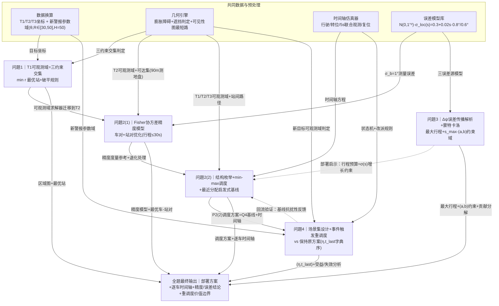

# 2026 数维杯秋季赛 B 题整卷解题框架（Rapid UAV Localization via Coordinated Mobile Vehicles）

> 输入依据：赛题 PDF 与 [B题-题意逐句翻译.md](B题-题意逐句翻译.md)（97 个编号单元、术语与联动链）。实现现状与验收命令见 [B题-公共模块复核与交接.md](B题-公共模块复核与交接.md)。

## 1. 整题建模主线

**研究对象**：100 m×100 m 场区内的"纯方位交叉定位部署系统"——5 辆云台观测车、5 座建筑、3 个已知警报目标（+问题 4 的 1 个新警报）。

**中心矛盾**：定位精度由站点几何决定（基线、交角、距离），而站点可行域又被车辆几何、视线遮挡、云台俯仰三重约束压缩；再叠加"5 车 6 任务槽"的复用时序与实时扰动。全题的公共内核是同一个**几何可行域 + 事件时间轴 + 方位误差**三元组。

**最终目标**：给出可执行的部署与调度方案（站点坐标、逐车时间轴），并量化其精度、误差鲁棒性与抗扰能力（η, t_last）。

**推荐共享主干（贯穿全文的四层骨架）**：

1. **几何引擎**（所有问共用）：圆盘净距与场地边界 + 三维视线遮挡判定（切触即遮挡）+ 云台俯仰可行性 $r \ge (H-2)/\tan 80^\circ$（本题目标均高于相机）+ 绕障行程。现有寻路以精确净距检查候选边，已通过此前的 B1 直连反例；有限角点图仍可能漏掉更短的可行路线。给定路线可用独立工具验算。
2. **事件时间轴仿真器**（问题 2(2)/4 共用）：每车状态机 行驶(3 m/s) → 转位($\max(\Delta\text{pan},\Delta\text{tilt})/30°/\text{s}$) → 联合观测(5 s，全员完成指向才启动) → 复位(回正东水平，可为 0) → 下一站。
3. **方位误差模型库**（问题 2(1)/3 共用机理）：方位角测量/指向误差经几何映射到定位或指向偏差；线性化解析 + 蒙特卡洛双轨验证。
4. **优化层**：问题 1 约束最小化 $r$；问题 2(1) 混合整数（选车对）+连续（站点）优化；问题 2(2) 结构枚举 + min-max 非线性规划；问题 4 事件触发重调度 + 字典序 (η, t_last) 评估。

**问题推进逻辑**：可行域刻画（基础）→ 精度机理与选站（估计+优化）→ 复用调度（决策）→ 误差传播（验证/机理深化，平行支线）→ 扰动重调度（决策扩展，回流检验问题 2(2)）。四个问题共享同一坐标系、同一套规则参数、同一个仿真器，天然满足"一卷一体"。

## 2. 跨问题联动链

关键回路说明：问题 3 与问题 2 平行（不构成计算依赖），但问题 3 的"行程越长定位误差越大"结论会以**部署启示**形式回流到问题 2(2)/4 的路径长度讨论；问题 4 以问题 2(2) 方案为唯一计算前置，其抗扰评估构成对基线的回流验证。

## 3. 全文统一建模口径

| 项目 | 统一口径 | 使用问题 |
|---|---|---|
| 坐标系 | 全局直角坐标 (x,y)，x 东 y 北，原点西南角，单位 m；时间 t 自 t=0 起算，单位 s | 全部 |
| 方位角约定 | 第 1 页原文指定正东起逆时针，第 2 页公式 $(50+R\cos\theta, 50+R\sin\theta)$ 及图 2 图注一致；按图 1 校验方向（T1 东北、T2 西北、T3 中南偏东） | 全部 |
| 目标坐标（数据预处理） | $T_1\approx(84.64,70.0,45)$，$T_2\approx(11.03,72.5,35)$，$T_3\approx(59.83,13.29,55)$（由题面公式换算，论文复核） | 全部 |
| 车辆模型 | 等效圆盘半径 $r_v=1.5$ m；站坐标=相机（车盘中心）水平坐标；中心距边界与建筑外表面 $\ge 1.5$ m | Q1/Q2/Q4 |
| 行驶 | 恒速 $v=3$ m/s；行程时间=绕障最短路径长$/v$；转向与避让不耗时但路径必须绕行膨胀障碍 | Q2/Q4 |
| 相机高度 | $h_c=2$ m；俯仰角 $e=\arctan\!\big((H-h_c)/r\big)$，$r$ 为相机到目标水平距离 | Q1/Q2/Q3 |
| 俯仰可行 | $e\in[-10^\circ,80^\circ]$；因 $H>h_c$ 恒有 $e>0$，等价于 $r\ge(H-2)/\tan 80^\circ$（T1/T2/T3/新警报分别 ≈7.58/5.82/9.34/8.47 m，论文复核） | Q1/Q2/Q4 |
| 遮挡判定 | 3D 视线段 (x,y,2)→(Tx,Ty,H) 与任一棱柱的棱/面/顶点**切触即遮挡**；遮挡集按闭集处理，站点离遮挡边界留裕度 δ | Q1/Q2/Q4 |
| 可观测域 $\mathcal{F}_T$ | 车辆几何 ∩ 无遮挡 ∩ 俯仰可行 的站点集合；问题 1 对 T1 求解，方法迁移 T2/T3/新警报 | Q1/Q2/Q4 |
| 云台时间 | 转位 $\tau_{slew}=\max(\|\Delta\text{pan}\|,\|\Delta\text{tilt}\|)/30°/\text{s}$；复位同理（回正东水平，已在该姿态则 0）；行进期云台锁定正东水平 | Q2(2)/Q4 |
| 联合观测 | 警报观测开始时刻 = 该警报两车**完成指向时刻的最大值**；观测历时 5 s | Q2(2)/Q4 |
| 测量误差（Q2(1)） | 两车方位测量误差独立 $N(0,1^{\circ^2})$，只作用于定位精度模型 | Q2(1) |
| 指向误差（Q3） | 定位逐轴 $\sigma_{loc}(s)=0.3+0.02s$ m、云台零偏 $0.8^\circ$、控制 $0.6^\circ$，三者独立；与 Q2(1) 的测量误差是**不同物理量**，分开陈述 | Q3 |
| 优化目标链 | Q1：$\min r$；Q2(1)：min 精度度量；Q2(2)：$\min\max_a t^{start}_a$；Q4：字典序 $(\max\eta,\ \min t_{last})$，$t_{last}$ 未完成封顶 60 s | 各问 |
| 评估窗口 | $t\in[0,60]$ s；$N$ 含新增警报；成功=两车完成指向（不含 5 s 观测时段） | Q4 |

## 4. 分问题求解思路

### 4.1 问题 1：T1 可观测域与最优观测站

#### 4.1.1 问题概述

- **任务**：刻画 T1 的车辆可观测域并绘图；在 $Q=1/r$ 度量下求最优站，报告 $r$、视线俯仰角、数学优化准则与破平规则。
- **已知（题面给定）**：T1 坐标（由警报换算）、B1–B5 几何、车辆圆盘 1.5 m、相机高 2 m、俯仰 $[-10^\circ,80^\circ]$、切触即遮挡、场区边界。
- **要求结果**：可观测域图 + 最优站坐标 + $r$ 与俯仰角 + 优化准则 + 破平规则。
- **本质**：几何/覆盖问题族——坐标→约束→区域→物理谓词→最优；**约束交集刻画 + 其上约束优化**。不属于统计或预测问题。
- **新引入假设（须声明）**：绘图分辨率（建议 0.1 m 网格、边界处 0.02 m 细化）；最优站集合若为一段圆弧，则"最优值相同"的站有多个，破平规则属于建模决策而非题面给定。

#### 4.1.2 总体求解思路

1. 三约束解析化：
   - 几何：$p$ 属于场区内缩 1.5 m 的矩形，且到每个建筑矩形的距离 $\ge 1.5$ m（建筑做 Minkowski 外扩）。
   - 俯仰：$e=\arctan(43/r)\le 80^\circ \Rightarrow r\ge 43/\tan 80^\circ\approx 7.58$ m（下界 $-10^\circ$ 自动满足，因 $H>2$）→ 目标地面投影为心的环形禁区。
   - 遮挡：对每个建筑做"点源阴影"测试——视线段与膨胀前棱柱求交，高度不足即遮挡；注意 $H=45$ 高于多数建筑，遮挡只在低站、远距侧向出现（如西侧远站看 T1 可能被 B3 棱线切割），区域呈带洞环形。
2. 区域计算：0.1 m 网格逐点三约束判定 → 连通域标记 → marching squares 提取边界；边界附近 0.02 m 加密。
3. 最优站：俯仰上限先给出半径下界 $r_{80}=(H-2)/\tan80^\circ$。只有半径下界对应的圆上存在满足净距和无遮挡的点，才能宣布该下界取到；交集有多点时再用破平规则。视线切触点不能纳入可行弧。
4. 破平规则（显式陈述，按优先级）：① 转位+复位耗时更小（pan 相对正东、tilt 绝对值更小）→ 直接有利于问题 2(2) 时间轴；② 距调度中心 O 更近；③ 与场区中心方向一致（为双站配置保留对侧空间）。规则本身做灵敏度说明。
5. 验证：网格法 vs 解析阴影多边形法边界重合度；最优站处三约束逐条复核（含切触检验）。

#### 4.1.3 可用模型及选型比较

| 可行模型/思路 | 模型本质与核心变量 | 完整实现步骤 | 所需数据与假设 | 优点 | 局限与失败风险 | 验证方法 | 与前后问题的接口 | 适用场景 |
|---|---|---|---|---|---|---|---|---|
| M1 网格离散+逐点判定 | 可观测域=三约束示性函数交集；变量=网格点 $(x,y)$ | ①生成 0.1 m 网格；②逐点判净距/遮挡/俯仰；③连通域+marching squares 边界；④在 $r\ge 7.58$ 环带上取 $\min r$ 弧段 | 全部题面数据；分辨率假设 | 实现简单、结论稳健、易出图 | 分辨率误差；边界切触判定需细化 | 0.02 m 加密复算边界位移；与 M2 边界对比 | 输出"可观测域求解器"给 Q2/Q4 | 主线方案 |
| M2 解析阴影多边形法 | 每栋建筑对点目标 T 生成地面阴影多边形（棱柱轮廓线与地面交点）；域=可行平面多边形的布尔交集 | ①对每建筑求轮廓棱的地面影线；②组装阴影多边形；③与净距域、俯仰环带做布尔交 | 几何精确、无网格假设 | 边界精确、计算快、理论优雅 | 实现复杂；非凸棱柱影线易错 | 与 M1 重合率；在最优站附近做 0.01 m 复核 | 同上；可作高保真审计 | 优化/校验方案 |
| M3 纯约束优化视角 | 直接对 $\min r\ \text{s.t.}\ g_i(p)\ge 0$ 做 NLP，区域仅示意 | ①约束写为不等式；②SLSQP 多起点；③绘图仅示意 | 同上 | 快速给最优站 | **不满足"刻画区域+绘图"的题面要求** | 仅作交叉核验 | — | 不推荐单独使用 |

**推荐模型**：M1 为主线 + M2 对最优弧段做高保真审计。
**选用理由**：题面明确要求"确定区域并绘图"，网格法稳健且可视化直接；M2 提供解析精度，两者互证构成论文的独立验证亮点；M3 不完整，仅作核验。
**备选模型**：若时间紧张，仅 M1 + 边界加密即可满足全部交付。
**多模型对比建议**：同一目标（T1）、同一约束实现（共享判定函数），比较边界 Hausdorff 距离与最优 $r$ 差异；报告分辨率灵敏度（0.2/0.1/0.05 m）。

#### 4.1.4 创新与改进方向

| 创新或改进方向 | 基础方案 | 具体改动与实现步骤 | 预期改进 | 新增工作量 | 验证指标与对照实验 | 风险及备用方案 | 影响的问题 |
|---|---|---|---|---|---|---|---|
| 解析阴影多边形高保真审计 | M1 网格区域 | 实现每建筑的点源阴影多边形并做布尔交，输出与网格边界的重合率 | 边界精度可证、体现几何功底 | 0.5–1 天 | 边界 Hausdorff 距离 <1 格 | 影线实现出错→退回网格加密 | Q1，方法迁移 Q2/Q4 |
| 面向时序的破平准则 | 有多个等距最优站时任选一个 | 候选破平准则为“转位+复位耗时最小” | 可作为 Q2(2) 选站候选；总观测起点还受路程、同步等待与站对几何影响 | 0.5 天 | 比较两种破平规则下 Q2(2) 的 $\max_a t^{start}_a$ | 破平效果由对照验证 | Q1→Q2(2) |
| 区域连通性/凹包分析 | 单一连通区域图 | 报告可观测域连通块数、面积、最长可视走廊；讨论对 T2/T3 的迁移差异 | 展示机理理解深度 | 0.5 天 | 与 T2/T3 区域图并列对比 | 无显著风险 | Q1，方法迁移 |

### 4.2 问题 2(1)：双站定位精度模型与 T2 最优车-站对

#### 4.2.1 问题概述

- **任务**：建立"精度—基线 B—交角 γ—目标距离 r"关系模型；定义并论证精度度量；在每车行程 ≤30 s 约束下选 2 车 + 最优站对；报告站坐标/B/γ/行程/度量；讨论 γ→0°/180° 与边界站退化及处理策略。
- **已知（题面给定）**：T2 坐标、V1–V5 初始位置、方位误差独立 $N(0,1^{\circ^2})$、30 s 时限、问题 1 的可观测域方法。
- **要求结果**：精度模型公式 + 选站结果五项输出 + 退化讨论。
- **本质**：纯方位（bearing-only）定位的估计理论 + 混合整数（选车）与连续（选站）耦合优化。核心变量：站对 $(s_1,s_2)$、距离 $d_1,d_2$、交角 γ、基线 B。
- **新引入假设（须声明）**：定位估计用两方位线的最小二乘交点（线性化）；站点须在 T2 可观测域内（题面"observation station"隐含，经口径表确认）；行程按绕障路径计算（GC02）；度量选用 A-最优（均方根位置误差）并附 D-最优对照。

#### 4.2.2 总体求解思路

1. 测量方程：$\phi_i=\operatorname{atan2}(T_{2y}-s_{iy},\ T_{2x}-s_{ix})+\varepsilon_i$，$\varepsilon_i\sim N(0,1^{\circ^2})$ 独立。
2. 线性化传播：$H_i=\partial\phi_i/\partial(T_x,T_y)=n_i^\top/d_i$（$n_i$ 为视线单位法向）。Fisher 信息 $I=\sigma_b^{-2}\sum_i n_i n_i^\top/d_i^2$，协方差 $C=I^{-1}=\sigma_b^2\big[\sum_i n_i n_i^\top/d_i^2\big]^{-1}$。
3. 结构结论（模型层）：$\det I\propto \sin^2\gamma/(d_1^2d_2^2)$ → 交角 γ 越接近 0°/180° 定位越病态；$|C|$ 随 $d_1d_2$ 增大而增大；基线 B 通过 $d_1,d_2,\gamma$ 的几何关系进入模型。指标：$\text{RMSE}=\sqrt{\operatorname{tr}C}$（主指标，A-最优），误差椭圆（$\det C$）与条件数（各向异性诊断）为辅。
4. 可行集：每车可达集 = 初始位置出发、绕膨胀障碍的测地距离 ≤90 m（30 s×3 m/s）的点集，与 $\mathcal{F}_{T_2}$ 相交。
5. 优化：$\min_{\{i,j\},\,s_i,s_j}\sqrt{\operatorname{tr}C}$；外层枚举 $\binom{5}{2}=10$ 个车对，内层 4 变量约束优化（粗网格筛选 + 多起点 SLSQP/模式搜索打磨）。
6. 退化讨论：γ→0°/180° 时 $C$ 沿基线方向方差发散（条件数→∞）→ 处理：设 $\gamma\in[\gamma_{\min},180^\circ-\gamma_{\min}]$（如 30°，灵敏度说明）；站点位于遮挡边界 → 切触即遮挡导致可行域突变 → 处理：站离边界留裕度 δ（如 0.5 m）并复验。
7. 验证：蒙特卡洛（采样 ε、精确交点公式）经验 RMSE vs 解析 $\sqrt{\operatorname{tr}C}$；最优站对处 30 s 行程与区域归属复算。
8. 备注：$C\propto\sigma_b^2$，故**最优站对选择与 σ_b 数值无关**（度量仅按比例缩放），可作为模型稳健性论据。

#### 4.2.3 可用模型及选型比较

| 可行模型/思路 | 模型本质与核心变量 | 完整实现步骤 | 所需数据与假设 | 优点 | 局限与失败风险 | 验证方法 | 与前后问题的接口 | 适用场景 |
|---|---|---|---|---|---|---|---|---|
| M1 解析 Fisher 协方差+连续优化 | 线性化测量模型；核心变量 $(s_1,s_2)$→$(d_1,d_2,\gamma)$ | 见求解思路 1–6 | $\sigma_b=1^\circ$；小误差线性化 | 公式闭式、机理解释强、退化分析自然 | 极小 r 处线性化偏差 | 蒙特卡洛对照 | 精度度量供 Q2(2) 参考 | 主线方案 |
| M2 蒙特卡洛经验面优化 | 直接采样误差、精确交点、经验 RMSE 曲面 | ①网格可达∩区域；②每格 MC(≥10⁴) 估 RMSE；③曲面优化+局部加密 | 同上；MC 样本量 | 分布精确、无近似 | 计算量大；网格粒度限制精度 | 置信区间；与 M1 逐点对比 | 同上 | 校验/备选 |
| M3 离散候选点枚举 | 可达∩区域取代表点集，组合枚举车对×站对 | ①候选点云；②10 车对×候选对评分；③取优 | 同上 | 实现最快 | 解被候选集限制 | 与 M1 最优值对比 gap | 同上 | 快速基线 |

**推荐模型**：M1 主线 + M2 独立验证（论文同时给出解析式与 MC 一致性图）。
**选用理由**：题面要求"建立关系模型+论证度量+讨论退化"，解析 Fisher 模型对 B/γ/r 的机理解释最直接，且 Q3 的误差传播与其共用机理，全文一致；MC 验证满足"justify + validate"双要求。
**备选模型**：若解析推导受限，用 M2 全程（须报告 MC 置信区间）。
**多模型对比建议**：同一车对、同一候选站格上，M1 vs M2 的 RMSE 相对偏差曲线（随 r 变化），报告最大偏差出现位置（近距小 r 处）。

#### 4.2.4 创新与改进方向

| 创新或改进方向 | 基础方案 | 具体改动与实现步骤 | 预期改进 | 新增工作量 | 验证指标与对照实验 | 风险及备用方案 | 影响的问题 |
|---|---|---|---|---|---|---|---|
| 条件数+裕度双诊断 | 只报 RMSE | 增加 $\operatorname{cond}(C)$ 与椭圆长短轴比作为站对质量二级指标；站离遮挡边界留 δ 裕度再优化 | 量化 Q2(1) 的近共线退化 | 0.5 天 | 对 γ 扫线绘 RMSE/cond 曲线，标出 γ_min 取值依据 | 指标过多冲淡主结论→图表合并 | Q2(1)，结论供 Q2(2) |
| σ 无关性论证 | 默认 σ_b=1° 求解 | 证明 $\arg\min$ 与 σ_b 无关并做 σ∈{0.5°,1°,2°} 复算 | 显示模型稳健、评委友好 | 0.25 天 | 复算表 | 无 | Q2(1) |
| 车对可达集预筛 | 10 车对全算 | 用测地距离下界先剔除不可达 90 m 的车对，减少无效优化 | 计算提效（非分数点，仅效率） | 0.25 天 | 预筛正确率 | 无 | Q2(1) |

### 4.3 问题 2(2)：车辆复用与路由（min-max 调度）

#### 4.3.1 问题概述

- **任务**：t=0 三警报同时发布，每警报 2 辆不同车、共 6 个车-任务槽、5 车可用，故至少有一车复用；设计分配+路由最小化 $\max_a t^{start}_a$；输出逐车完整时间轴（出发/到站/转位/观测起止/复位/再出发）；另定义“最近分配启发式”基线并对比分析差异来源。
- **已知（题面给定）**：T1/T2/T3 与 V1–V5 全部数据；时序规则 GC/TS 全套；各目标可观测域（问题 1 方法）。
- **要求结果**：最优方案 + 时间轴 + 基线对比。
- **本质**：小规模"指派+排序+连续选址"的 min-max 调度问题（组合结构 240 种，见下），共享仿真器约束。
- **口径与分析范围**：观测起点取两车完成指向的较晚时刻（GC11）；复位完成后才出发（TS04/TS05）。若先只看五车均使用、恰一车复用，须标注这是受限搜索。最近分配启发式是题目要求自行定义的基线。

#### 4.3.2 总体求解思路

1. 结构计数复核：在**五车均使用、恰一车复用**的子集中，选复用车 5 种、其有序警报对 $3\times2$ 种、将其余四车分到四个剩余槽有 $4!$ 种。复用车所在两警报已经区分了复用车与搭档，只有第三个警报的两名普通车可互换去重，故 $5\times3\times2\times4!/2=360$ 种。题面未要求五车全用，这一计数不代表全可行域。
2. 时间轴方程（每车序列 $a_1\!\to\!a_2$）：$\text{arrive}_1=d(s^0_k,s_{k,a_1})/3$；$\text{slew}_1=\max(|\text{pan}_1|,|\text{tilt}_1|)/30$；$t^{start}_{a_1}=\max(\cdot,\cdot)$（两车）；$\text{end}=t^{start}+5$；$\text{reset}=\max(|\text{pan}_1|,|\text{tilt}_1|)/30$；$\text{arrive}_2=\text{end}+\text{reset}+d(s_{k,a_1},s_{k,a_2})/3$；依此类推。站约束 $s_{k,a}\in\mathcal{F}_{T_a}$。
3. 求解：min-max → epigraph 形式 $\min t^\*$ s.t. $t^\*\ge t^{start}_a\ \forall a$；多起点 NLP 可找可行候选。剪枝之前须证明所用下界对全部被剪去的候选成立。
4. 最优性证据：枚举离散结构和局部 NLP 都不能单独证明全局最优。只有验证了上下界和覆盖范围，才能报告 gap；保守外扩路径长与缩小后的站点搜索域都不能直接用于给原问题定下界。
5. 基线启发式（精确定义）：① 每警报独立选站：在 $\mathcal{F}_{T_a}$ 上求最小化"两车行程时间较大者"的站（minimax 选址）；② 车辆指派：每警报取未占用且行程最小的两车，冲突按警报顺序 T1→T2→T3 先到先得；③ 被迫双任务的车按"边际延迟最小"排序其两个警报。与优化方案同约束、同仿真器运行。
6. 对比分析：目标值差、逐警报开始时间差、单车利用率差；差异来源归因（贪心忽略连锁行驶/复位开销、忽略结构级 min-max 交互、选站只顾本警报）。
7. 验证：最优方案时间轴逐事件重算（仿真器复演）；约束合规清单（每警报 2 车、站在区域内、规则逐条核对）；对转位/复位参数 ±10% 灵敏度。

#### 4.3.3 可用模型及选型比较

| 可行模型/思路 | 模型本质与核心变量 | 完整实现步骤 | 所需数据与假设 | 优点 | 局限与失败风险 | 验证方法 | 与前后问题的接口 | 适用场景 |
|---|---|---|---|---|---|---|---|---|
| M1 结构枚举+min-max NLP（共享仿真器） | 混合整数外层+连续内层；变量=分配结构+6 站坐标 | 见思路 1–4、7 | 全部规则参数 | 便于检查离散覆盖和复演时序 | 360 种仅覆盖五车全用的结构；连续子问题非凸 | 可行性复算、时间轴复演；有效下界另验 | 选定可行方案后供 Q4 基线 | 主线方案 |
| M2 约束规划/MINLP 直接建模 | CP/MINLP 求解器一次建模 | ①时间轴方程线性化分段近似几何；②求解器全局解 | 同上 | "全局最优"名义 | 几何非线性难线性化、求解器依赖、失真风险 | 与 M1 对比 | 同上 | 不推荐（失真） |
| M3 元启发式（SA/GA）+ 仿真器评估 | 决策空间=(分配,顺序,站点)直接搜索 | ①编码；②仿真器算目标；③SA/GA 迭代 | 同上 | 实现灵活、无梯度需求 | 无最优性证据、随机性 | 多种子重复、与 M1 gap | 同上 | 备选/放大规模时 |

**推荐模型**：M1；M3 作为"规模可扩展性"讨论与第二对照，M2 不采用（几何失真）。
**选用理由**：6 个任务槽便于逐类核验离散结构。连续站点经可行性复算后，得到可比较的候选时间轴。Q4 可复用其事件口径，扰动时刻的状态接续仍待验证。
**备选模型**：若 NLP 收敛不稳，用 M3 补充可行候选，报告可行目标值和复演结果；有独立有效的下界时再报告 gap。
**多模型对比建议**：同一目标（$\max_a t^{start}_a$）、同一仿真器评估，报告 M1 vs M3 的最优值差与运行时间；基线启发式按题面要求单列。

#### 4.3.4 创新与改进方向

| 创新或改进方向 | 基础方案 | 具体改动与实现步骤 | 预期改进 | 新增工作量 | 验证指标与对照实验 | 风险及备用方案 | 影响的问题 |
|---|---|---|---|---|---|---|---|
| 复位感知的任务排序 | 双任务车顺序任取 | 对 doubling 车枚举两顺序，并使第二站选择偏向"方位角连续"（减小复位+转位） | $t^\*$ 降低（可测量） | 0.5 天 | 两顺序的 $t^\*$ 对比表 | 效果不显→仅作机理分析 | Q2(2)、Q4 |
| 下界与 gap 报告 | 只报候选目标值 | 先验证下界与搜索范围，再与可行上界比较 | 明确结果能支持多强的最优性主张 | 0.5 天 | 下界依据和 gap 表 | 无有效下界或差距大时报告已找到的可行方案 | Q2(2) |
| 时间轴甘特图+事件表 | 纯文字时间轴 | 逐车甘特图 + 六类事件时刻表并排 | 可读性/交付完整性 | 0.5 天 | 与题面 6 事件清单逐项核对 | 无 | Q2(2)、Q4 |

### 4.4 问题 3：Δψ 误差传播模型

#### 4.4.1 问题概述

- **任务**：建立三误差源到 Δψ 的传播模型；求 $P(|\Delta\psi|\le 5^\circ)\ge 0.95$ 的最大允许行程；80 m 下反推 $\sigma(s)=a+bs$（$a,b\ge0$）约束；论证近似与数值方法并验证；三源贡献分解 + 部署启示。
- **已知（题面给定）**：$(\delta x,\delta y)=\hat P-P$ 逐轴独立 $N(0,\sigma_{loc}^2(s))$，$\sigma_{loc}=0.3+0.02s$ m；云台零偏 $0.8^\circ$、控制 $0.6^\circ$ 独立；目标已知、水平距离固定 40 m；Δψ 卷绕到 $[-180^\circ,180^\circ)$。
- **要求结果**：传播模型 + 最大行程 + (a,b) 约束域 + 验证 + 贡献排序 + 启示。
- **本质**：测量误差传播（机制清晰的一维角度误差合成）+ 由概率约束反推参数的逆问题。**与 Q2(1) 的测量误差是不同物理量**（Q2(1) 是方位测量精度、Q3 是指向可靠性），论文须分开陈述。
- **新引入假设（须声明）**：① 小角近似 $\Delta\psi_{loc}\approx\delta_\perp/r$（弧度）；② 卷绕在 $|\Delta\psi|\le 5^\circ$ 量级下不起作用；③ 云台两角误差直接以度加到方位角上；④ s 为自出发起的累计行程（题面口径，不引入"重定位清零"）。

#### 4.4.2 总体求解思路

1. 几何项：真实方位 $\phi=\operatorname{atan2}(T_y-P_y,T_x-P_x)$；指令方位由 $\hat P$ 计算。位置误差在视线法向的投影 $\delta_\perp=\delta\cdot n\sim N(0,\sigma_{loc}^2(s))$（各向同性，任意方向投影同方差），故 $\Delta\psi_{loc}\approx\dfrac{\delta_\perp}{r}\cdot\dfrac{180}{\pi}$（度），标准差 $\sigma_1=\dfrac{180}{\pi}\cdot\dfrac{\sigma_{loc}(s)}{40}\approx 1.4324\,\sigma_{loc}(s)$ 度。
2. 合成（三源独立）：$\Delta\psi\approx N(0,\sigma_{tot}^2)$，$\sigma_{tot}^2=\sigma_1^2+0.8^2+0.6^2$（度²）。
3. 概率约束→行程上限：$P(|\Delta\psi|\le5^\circ)\ge0.95 \Leftrightarrow z_{0.975}\,\sigma_{tot}\le5$（$z_{0.975}\approx1.96$）→ $\sigma_{tot}\le 2.55^\circ$ → $\sigma_1\le\sqrt{2.55^2-0.8^2-0.6^2}$ → $\sigma_{loc}(s)\le \sigma_{\max}$ → $s_{\max}=(\sigma_{\max}-0.3)/0.02$。论文代入数值并保留公式链。
4. (a,b) 约束：同链在 $s=80$：$a+80b\le\sigma_{\max}$，$a\ge0,\ b\ge0$（平面可行域，画图）。
5. 近似论证：线性化相对误差 $\approx(\delta_\perp/r)^2/3$，在 $\sigma_{\max}$ 量级下 <0.1%；卷绕在 $\pm5^\circ$ 内恒等；分布合成精确（独立正态线性组合）。以上三条逐条给出数值证据。
6. 验证：蒙特卡洛（不近似：精确 $\operatorname{atan2}$、wrap、采样三源）估计 $P(|\Delta\psi|\le5^\circ)$，与解析值对比；$s$ 扫线绘 $P$–$s$ 曲线，标出 $s_{\max}$。
7. 贡献分解：方差占比 $\sigma_i^2/\sigma_{tot}^2$ 随 $s$ 变化（短程云台主导、长程定位主导），给出 s-扫线图与排序表。
8. 部署启示：控制单次任务累计行程；长行程任务拆分/换车；站点选择偏向近距（联动 Q3 的 $\sigma_{loc}(s)$ 增长与 Q2 的 30 s=90 m 预算之间留裕度）。

#### 4.4.3 可用模型及选型比较

| 可行模型/思路 | 模型本质与核心变量 | 完整实现步骤 | 所需数据与假设 | 优点 | 局限与失败风险 | 验证方法 | 与前后问题的接口 | 适用场景 |
|---|---|---|---|---|---|---|---|---|
| M1 解析线性传播 | 一维正态合成；核心量 $\sigma_{tot}(s)$ | 见思路 1–4 | 独立性、小角近似 | 闭式、可反推 (a,b)、机理清晰 | 近似在极端参数下失真 | MC 对照 | 启示回流 Q2(2)/Q4 讨论 | 主线方案 |
| M2 全量蒙特卡洛 | 精确非线性仿真求经验分位数 | ①采样 δ、ε₀、εc；②精确 atan2+wrap；③经验 $P$ 与 $s_{\max}$ | 同上+样本量 | 无近似、可给置信区间 | 无法直接反推 (a,b)（需嵌套搜索） | 与 M1 的 $P$–$s$ 曲线重合度 | 同上 | 验证轨 |
| M3 分布无关保守界 | Cantelli/Chebyshev 上界 | 由 $\sigma_{tot}$ 推概率下界再反推 $s$ | 仅二阶矩 | 对正态性存疑时稳健 | 界太松、$s_{\max}$ 明显偏小 | 与 M1/M2 差距表 | 同上 | 稳健性附注 |

**推荐模型**：M1 主线 + M2 验证 + M3 附注（一条即可）。
**选用理由**：题面明确"justify approximations + validate"，解析+MC 双轨是最直接的满分结构；(a,b) 反推只有闭式模型能给出显式约束域。
**备选模型**：若被质疑正态性，M3 提供保守结论。
**多模型对比建议**：同一 $s$ 网格上三条 $P(|\Delta\psi|\le5^\circ)$ 曲线同图；报告 $s_{\max}$ 三值差。

#### 4.4.4 创新与改进方向

| 创新或改进方向 | 基础方案 | 具体改动与实现步骤 | 预期改进 | 新增工作量 | 验证指标与对照实验 | 风险及备用方案 | 影响的问题 |
|---|---|---|---|---|---|---|---|
| s-扫线贡献分解图 | 只给 s_max 处的占比 | 对 s∈[0,100] 连续绘三源方差占比堆积图，标注云台主导→定位主导的交点 | 机理可视化、直接支撑"部署启示" | 0.5 天 | 交点 s 值与解释 | 无 | Q3 结论 |
| 与 30 s 预算的交叉论证 | 各问独立结论 | 将 $s_{\max}$ 与 Q2(1) 的 90 m 行程上限并列，讨论"指向可靠性预算 < 行驶预算"的裕度设计 | 跨问联动亮点 | 0.25 天 | 数值并列表 | 数值以论文计算为准 | Q3→Q2(2)/Q4 |
| wrap 敏感性附注 | 默认卷绕无影响 | 构造极端 δ⊥ 使方位差逼近 ±180° 检验 wrap 边界 | 严谨性加分 | 0.25 天 | wrap 触发概率上界 | 无 | Q3 |

### 4.5 问题 4：扰动重调度与策略比较

#### 4.5.1 问题概述

- **任务**：以 Q2(2) 方案为基线；t=5 s 发生 (a) 新警报（θ∈[0°,360°)、R∈[30,50] m、H=50，需两车）/ (b) 五车恰一车等概率失效（失效车退场不设障）/ (c) 通信中断 $[5,t_{rec}]$、$t_{rec}\in(5,30]$（中断期任务继续、恢复后才接新指令）及组合；建重调度模型并与"保持原方案"比较；单扰动+组合情景；场景集设计与准则论证；报告 (η, t_last)、策略、时间轴；分析重调度受益/失效场景及原因。
- **已知（题面给定）**：Q2(2) 基线与全套规则；已开始观测的警报锁定、未开始的车可改派；无先知、事件触发；窗口 [0,60] s；η=k/N、t_last 封顶 60；字典序先 η 后 t_last。
- **要求结果**：每场景 (η,t_last) + 策略 + 时间轴 + 价值边界分析。
- **本质**：有限时域动态调度 + 情景化策略评估（deterministic re-optimization / rolling horizon + paired comparison）。
- **待确认口径**：基线在 5 s 前是否已有观测开始，须由时间轴确定；若事件恰在 5 s，明确同一时刻的事件顺序。改派前保留车辆实际位置、姿态和任务阶段；行驶时云台须正东水平（GC07）。明确失效信息可用时点、是否允许中断期计算，以及恢复时点。第 5 页写 $[5,t_{rec}]$、$t_{rec}\in(5,30]$，又称时长为 $[5,30]$ s，建场景前须明确采用口径（见 Q4-05）。

#### 4.5.2 总体求解思路

1. 基线核对：从 Q2(2) 时间轴提取 t=5 s 状态（各车位置/姿态/任务），确认锁定集合；该表入论文。
2. 重调度模型：在 5 s 或恢复时刻读取车辆与任务状态。每个警报需要两辆不同车同步，跨警报可按顺序复用，所以不能用“剩余车数 ≥ 2×待观测警报数”判定可完成性。评估按题面先比较 $\eta$，同值时再比较 $t_{last}$；有待观测警报未启动时，按题面令 $t_{last}=60$ s。通信中断期间按原指令继续，恢复后方可执行新指令。
3. 策略集：P0 保持原方案（新警报不响应，(a) 场景 η≤3/4）；P1 事件触发全重优化；P2 规则式调度（最近可行车优先、警报按"最早可完成"优先）作为可解释中间策略。
4. 场景集设计（题面要求论证）：方位维 12 个 30° 扇区取中心角；R 取 {30, 40, 50}（两端+中点）；(b) 5 个失效对象等权；(c) $t_{rec}\in\{10,20,30\}$；组合场景 {a, b, c, a+b, a+c, b+c, a+b+c}。全因子过大 → 单扰动小维度全枚举 + (a) 网格抽样 + 组合场景取"代表+最坏"（如新警报位于剩余车辆最难到达的扇区）。准则：覆盖参数域、包含极端角点、总场景数 ≤ 论文可展示规模（约 60–100 个），权重均匀。
5. 评估：每场景×策略输出 (η, t_last)（+逐警报开始时刻、空闲时间等二级指标）；配对比较 Δη、Δt_last；归纳重调度受益条件（如失效车在关键路径、新警报近空闲车）与失效条件（中断长→响应晚、剩余车<2×待观测数→结构性失败）。
6. 验证：P0 在无扰动场景应复现 Q2(2) 结果（回归测试）；重调度方案时间轴复演；η/t_last 计算伪代码与题面定义逐条对照；随机场景子集做种子灵敏度。

#### 4.5.3 可用模型及选型比较

| 可行模型/思路 | 模型本质与核心变量 | 完整实现步骤 | 所需数据与假设 | 优点 | 局限与失败风险 | 验证方法 | 与前后问题的接口 | 适用场景 |
|---|---|---|---|---|---|---|---|---|
| M1 事件触发重优化（共享仿真器） | 决策时点 τ 的确定性重解；变量=剩余分配+站点+顺序 | 见思路 1–3、6 | t=5 状态、改派规则 | 与 Q2(2) 同口径、逐场景可解释 | 场景多时计算量大（可剪枝） | P0 回归测试；时间轴复演 | 直接输出 (η,t_last) | 主线方案 |
| M2 规则式优先级策略 | 确定性规则映射状态→指令 | 定义规则集并在仿真器上执行 | 同上 | 可解释、稳定、作对照 | 性能通常次优 | 与 P1 配对差值 | 同上 | 第二策略 |
| M3 情景加权期望优化 | 对场景集求期望 η 最大的鲁棒方案 | 场景采样+期望目标优化初始/响应策略 | 场景概率假设（题面只给均匀性的 (b)） | 可给出"平均意义最优" | 超出题面要求的比较框架；需概率假设 | 与 M1 的逐场景对比 | 作为扩展讨论 | 创新支线 |

**推荐模型**：M1（重调度）与 P0（保持原案）按题面对比，P2 增强分析维度；M3 仅作讨论性扩展，不进入主对比。
**选用理由**：题面要求"rescheduling model + compare vs retaining original"，M1/P0 是最小完备对照；同一仿真器保证口径一致；P2 提供第三个参照使"何时受益"的归因更可信。
**备选模型**：若计算量超限，场景集缩减至 24–36 个（方位 8 扇区×R 两端），结论方向不变。
**多模型对比建议**：逐场景配对（同场景同随机实现），主表 (η,t_last)、辅表 Δ；按扰动类型分层汇总。

#### 4.5.4 创新与改进方向

| 创新或改进方向 | 基础方案 | 具体改动与实现步骤 | 预期改进 | 新增工作量 | 验证指标与对照实验 | 风险及备用方案 | 影响的问题 |
|---|---|---|---|---|---|---|---|
| 重调度价值边界图 | 逐场景散点 | 以 (θ 扇区, R, 扰动类型) 为轴绘制 Δη/Δt_last 热力图，标出"重调度无益甚至有害"区域 | 直接回应 Q4-18 的"benefits vs poorly" | 0.5 天 | 热力图+成因注释 | 场景稀疏→加密关键扇区 | Q4 结论 |
| 关键路径失效诊断 | 只报失效结果 | 对 (b) 的 5 个失效对象逐一标注其在基线中的角色（关键路径/冗余） | 归因清晰、体现机理 | 0.5 天 | 失效对象×Δη 表 | 无 | Q4 |
| 中断-恢复延迟分析 | 固定 t_rec | $t_{rec}$ 扫线（5→30）绘 η/t_last 响应曲线，找性能拐点 | 量化 (c) 的敏感性 | 0.25 天 | 扫线图 | 无 | Q4 |
| 鲁棒化初始排程（扩展讨论） | Q2(2) 基线 | 讨论在基线中预留空闲车/裕度的代价与抗扰收益（明确标注为超出题面的扩展） | 展示决策视野 | 0.5 天 | 与严格基线对照 | 与题面口径冲突→仅作讨论 | 全文结论 |

## 5. 推荐的全文技术路线

**路线总览（一次实现、四问复用）**：

1. **公共模块验收**：用图 1 核验坐标，再检查净距、遮挡、俯仰与时序。按 [模块复核与交接](B题-公共模块复核与交接.md) 运行回归，逐段复核候选路线；把有限图上的寻路结果与真实最短行程区分开。
2. **问题 1**：网格区域（0.1 m）+ 边界核验 → 区域图、最优站集合、$r$ 与俯仰角；存在等值最优站时说明破平规则。
3. **问题 2(1)**：Fisher 协方差模型推导 → 10 车对×可达∩区域优化 → 最优车-站对五项输出 → MC 验证图 + γ 扫线退化图。
4. **问题 2(2)**：声明结构搜索范围 → 检查站对定位与行程可行性 → 用仿真器复演候选方案（甘特图+事件表）→ 最近分配启发式对照 → 差异归因；有有效下界时报告 gap。
5. **问题 3**：解析传播链 → $P$–$s$ 曲线与 $s_{\max}$ → (a,b) 可行域图 → MC 验证 → 贡献分解 s-扫线 → 部署启示（含与 90 m 行驶预算的交叉讨论）。
6. **问题 4**：t=5 s 状态核对表 → 场景集（论证准则）→ P0/P1/P2 三策略逐场景 (η,t_last) → 热力图与价值边界 → 受益/失效归因。
7. **全文验证闭环**：每问一个独立验证（M1 内嵌）+ 全文口径一致性检查（第 8 节清单）+ 结论段汇总部署建议。

**跨问接口**：四问共享几何和时序口径。Q2(1) 为方位测量误差，Q3 为指向误差；90 m 行驶预算与 Q3 在指定参数下算出的容许行程可并列，适用范围须各自交代。Q4 以 Q2(2) 的可行方案为基线，当前仿真接口还缺少扰动时刻状态与新警报输入。

## 6. 多模型对比与验证设计

| 主张/结论 | 独立验证设计 | 通过标准 |
|---|---|---|
| Q1 可观测域边界正确 | 网格法 vs 阴影多边形法边界对比；最优站三约束逐条复算；分辨率减半边界位移 | 边界 Hausdorff 距离 <1 细网格；最优站复算全通过 |
| Q1 最优值与破平规则 | 在最优弧段多点复算 r；报告等值弧段长度 | 弧段上 r 差 <10⁻⁶ 量级 |
| Q2(1) 精度模型 | 蒙特卡洛经验 RMSE vs $\sqrt{\operatorname{tr}C}$（多站对、多 r） | 相对偏差 <2%（近距处单独说明） |
| Q2(1) 30 s 约束 | 最优站对行程按可见性图复算 | 路径长 ≤90 m 且绕行合法 |
| Q2(2) 可行性与最优性主张 | 几何与时间轴复演；核验搜索范围；对照独立有效下界（若有） | 复演一致，最优性主张与证据范围相符 |
| Q2(2) 基线对比 | 同仿真器、同约束运行启发式 | 差异归因可复现 |
| Q3 解析传播 | MC（精确 atan2+wrap）经验概率 vs 解析；$P$–$s$ 曲线重合 | 偏差 <1 个百分点；$s_{\max}$ 差 <1 m |
| Q3 近似合法性 | 线性化相对误差、wrap 触发概率数值证据 | 均给出量级证明 |
| Q4 重调度有效 | P0 无扰动回归测试=Q2(2)；逐场景配对差值；种子灵敏度 | 回归通过；方向性结论跨种子稳定 |
| Q4 指标口径 | η/t_last 伪代码与题面逐条对照表 | 逐条一致 |

## 7. 论文落地清单

**必交（题面显式要求）**：

1. 公式：坐标换算式、三约束不等式（含 $r\ge(H-2)/\tan80^\circ$）、遮挡判据、Fisher 协方差与精度度量、时间轴方程组（转位/复位 max 规则）、min-max epigraph、Δψ 传播链与 $\sigma_{tot}$、$s_{\max}$ 公式、$a+80b\le\sigma_{\max}$ 约束、η/t_last 定义。
2. 算法：区域网格化+边界提取、可见性图最短路、结构枚举+NLP 流程图、MC 流程、场景生成规则、重调度流程。
3. 表：目标坐标表；Q1 最优站与 $r$/俯仰角表；Q2(1) 五项输出表；Q2(2) 逐车六事件时间轴表 + 基线对比表；Q3 参数与贡献占比表；Q4 场景×策略 (η,t_last) 主表。
4. 图：Q1 可观测域图（含最优站标注）；Q2(1) 误差椭圆/γ 扫线图；Q2(2) 甘特图；Q3 $P$–$s$ 曲线与 (a,b) 可行域图、贡献堆积图；Q4 Δη/Δt_last 热力图。
5. 结论：部署启示（Q3）+ 重调度价值边界（Q4）+ 全文口径声明（方位角约定、切触即遮挡、开始时刻口径）。

**可选增强**：阴影多边形解析审计、σ 无关性论证、复位感知排序对比、鲁棒初始排程讨论、时间轴 3D 示意。

**附录代码**：geometry.py（三约束+最短路）、simulator.py（时间轴状态机）、q1_region.py、q2_accuracy.py、q2_schedule.py、q3_error.py、q4_reschedule.py；随机种子固定说明。

## 8. 完整性与断链检查

| 检查项 | 结果 | 说明 |
|---|---|---|
| 编号问题覆盖 | 通过 | Q1、Q2(1)、Q2(2)、Q3、Q4 均有 4.1–4.5 四段式分析；与翻译报告第 4 节逐一对应 |
| 显式交付覆盖 | 通过 | 绘图/五项输出/时间轴六事件/基线对比/(a,b) 约束/场景论证/(η,t_last)/归因分析 全部进入第 7 节清单 |
| 约束覆盖 | 通过 | 三约束、30 s、5 s、30°/s max 规则、复位 0 特例、切触即遮挡、锁定规则、指令冻结、字典序、60 s 封顶全部进入口径表与对应模型 |
| 跨问依赖 | 无断链 | Q1→Q2(1)/Q2(2)（区域方法）、Q2(2)→Q4（基线+仿真器）、Q3→Q2(2)/Q4（启示级回流，不构成计算依赖）；无循环计算 |
| 口径复核 | Q4 待确认 | 方位角按原文、公式、图注一致的逆时针；观测起点统一为 GC11；Q4-05 的恢复时刻与时长表述不一致 |
| 数据缺口 | 无 | B 题无外部附件；全部数据在题面/表 1/图 1/图 2 |
| 需声明或核实的口径 | 待实现 | 网格分辨率、结构搜索范围、启发式定义、5 s 基线状态、恢复时间及信息可用时点 |
| 回喂下游前的验收 | 部分通过 | B1 旧反例已通过，有限图最短路仍有局限；演示未校验站对的定位退化；扰动状态接续未实现。详见交接文档 |
| 结果真实性 | 框架未捏造数值 | 所有数值留待论文实现与验证；框架内给出的均为公式链与结构（含少量数据换算/近似量级，已标注复核） |
