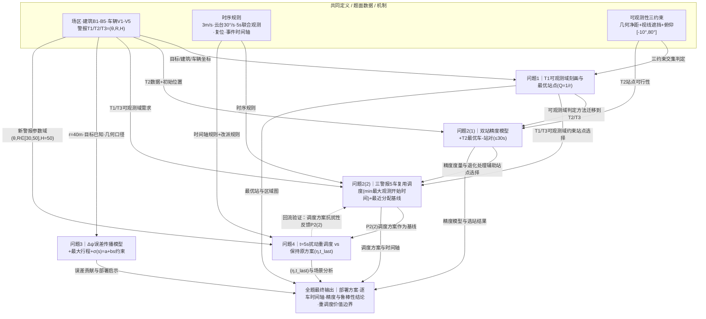

# 2026 数维杯秋季赛 B 题：Rapid UAV Localization via Coordinated Mobile Vehicles（题意逐句翻译）

> 来源文件：`D:\数维杯\2026赛题\2026年第十二届数维杯全国大学生数学建模挑战赛（秋季赛）赛题\B题\2026_“ShuWei Cup”B_Problem.pdf`（与用户提供的赛题压缩包内 B 题 PDF 一致）。2026-11-20 复核见 [B 题公共模块复核与交接](B题-公共模块复核与交接.md)。

## 1. 整题概览

**题目锚点**：`2026_"ShuWei Cup" Problem B: Rapid UAV Localization via Coordinated Mobile Vehicles`（第 1 页标题行）。

**整题一句话翻译**：在 100 m × 100 m 的方形场区内（含 5 座建筑、调度中心 O=(50,50)、5 辆初始位置给定的观测车），对 3 个已知警报目标 T1/T2/T3（由方位角 θ、水平距离 R、高度 H 描述）完成纯方位交叉定位的部署与调度：问题 1 刻画单目标可观测域并求最优观测站；问题 2(1) 建立双站定位精度模型并为 T2 选最优车-站组合；问题 2(2) 在 5 车 6 任务槽的复用约束下最小化三个警报的最大观测开始时间；问题 3 建立车辆定位误差与云台指向误差到方位偏差 Δψ 的传播模型并反推允许行驶距离与 σ(s)=a+bs 的参数约束；问题 4 以问题 2(2) 方案为基线，在新增警报、车辆失效、通信中断三类扰动下设计实时重调度模型，并以 (η, t_last) 双指标在 60 s 窗口内比较重调度与保持原方案。

**问题推进逻辑**：几何可行域（Q1）→ 精度模型与选站（Q2(1)）→ 多任务复用调度（Q2(2)）→ 误差传播与鲁棒性量化（Q3，与前问平行但共用几何）→ 扰动重调度与政策评估（Q4，复用 Q2(2) 基线）。全题无外部数据附件，所有参数均在题面与表 1、图 1、图 2 中给定。

**审计注**：PDF 标题行之前无通用样板文字（无赛名年份头、格式提醒、页眉水印），无需排除项。

## 2. 逐句题意翻译与联动表

| 编号 | 题干原句 | 通俗而精确的翻译 | 明示条件/数据 | 隐含建模信号 | 与前后内容的联动 | 漏读后果 | 后文必须出现的证据 | 来源页码/位置 |
|---|---|---|---|---|---|---|---|---|
| BG01 | When small Unmanned Aerial Vehicles (UAVs) appear in low-altitude airspace, reconnaissance systems can only generate coarse alert information containing the target's approximate azimuth, horizontal distance, and altitude. | 低空出现小型无人机时，侦察系统只能给出粗警报：目标的近似方位角、水平距离、高度。 | 警报三元组 (θ, R, H) 的来源与粗略性 | context+entity：警报是输入数据而非精确测量 | defines Q2 的定位必要性、Q3 的误差动机 | 误以为警报即精确坐标 | Q2 的定位模型、Q3 的误差模型 | 第 1 页 §I 第 1 段 |
| BG02 | Such information alone cannot yield the target's precise geolocation. | 仅凭警报信息无法得到目标的精确定位。 | — | context：为什么需要双站交叉 | motivates Q2(1) | 低估定位精度问题的地位 | Q2(1) 精度模型 | 第 1 页 §I 第 1 段 |
| BG03 | To enable rapid direction-finding and localization, the dispatch center dispatches ground-based mobile observation vehicles (hereafter observation vehicles) fitted with gimbal-mounted cameras to vantage positions for target bearing measurement. | 调度中心派出装有云台相机的地面移动观测车，到有利位置测量目标方位。 | "observation vehicles" 命名定义 | entity+mechanism：车是可移动决策变量 | defines 全题决策对象（选车+选址） | 把车当固定设施 | Q1–Q4 全部 | 第 1 页 §I 第 1 段 |
| BG04 | A single observation vehicle yields only one bearing line and cannot determine the target's horizontal position. | 单车只产生一条方位线，不能确定目标水平位置。 | — | mechanism：单站不可定位 | defines Q2(1) 双站必要性 | 试图单站定位 | Q2(1) | 第 1 页 §I 第 2 段 |
| BG05 | Two vehicles observing synchronously from distinct azimuths can localize the target via the intersection of two bearing lines. | 两车从不同方位同步观测，两条方位线的交点即目标水平位置。 | "synchronously"、"distinct azimuths" | mechanism：同步性+方位差是定位前提 | defines Q2(1) 与"观测开始时间"概念 | 忽视同步要求导致时间轴错误 | Q2(2) 时间轴、GC11 | 第 1 页 §I 第 2 段 |
| BG06 | The target altitude is provided directly by the alert message. | 目标高度由警报消息直接给出。 | H 为已知量 | given：H 已知、无需估计 | supplies GC09/GC10 的遮挡与俯仰判断 | 把 H 当未知量估计 | Q1、Q2、Q3 | 第 1 页 §I 第 2 段 |
| BG07 | It constrains whether the line-of-sight elevation falls within the gimbal's allowable range, determines whether buildings occlude the line-of-sight, and influences subsequent pointing-error analysis. | 高度 H 三个用途：判断视线俯仰角是否在云台允许范围、判断建筑是否遮挡视线、影响后续指向误差分析。 | H 的三种用途 | mechanism：H 是三维几何与误差计算的公共输入 | supplies Q1（俯仰+遮挡）、Q3（指向误差） | 只用 (Tx,Ty) 丢掉三维判断 | Q1 可观测域、Q3 | 第 1 页 §I 第 2 段 |
| BG08 | A too-short baseline between the two stations, or an excessively large or small intersection angle, will amplify localization errors. | 基线过短或交角过大/过小都会放大定位误差。 | 基线 B、交角 γ 两个站参 | mechanism：精度由站几何决定 | motivates Q2(1) 精度模型、Q2(1) 退化讨论 | 只报精度数值不建几何机理 | Q2(1) 模型与退化讨论 | 第 1 页 §I 第 3 段 |
| BG09 | Consequently, station geometry directly governs intersection-based positioning accuracy. | 因此站点几何直接决定交叉定位精度。 | — | objective：站几何是优化对象 | reinforces Q2(1) | 忽略几何项只算行程 | Q2(1) | 第 1 页 §I 第 3 段 |
| BG10 | During deployment, vehicles are constrained by building obstructions, line-of-sight occlusion, and arrival-time deadlines. | 部署期车辆受建筑阻挡、视线遮挡、到达时限三类约束。 | 三类约束清单 | constraint：Q1–Q2 的约束骨架 | supplies Q1 三约束、Q2(1) 30 s 时限 | 漏掉任一类约束导致站点不可行 | Q1、Q2(1)、Q2(2) | 第 1 页 §I 第 3 段 |
| BG11 | New alerts may arrive unexpectedly, while vehicle failures or communication outages can also occur. | 新警报可能突然到达，车辆失效与通信中断也可能发生。 | 三类扰动预告 | context：为 Q4 埋伏笔 | motivates Q4 | Q4 无背景可依 | Q4 | 第 1 页 §I 第 3 段 |
| BG12 | This problem addresses core questions: which vehicles to select, where to place observation stations, how one single vehicle can sequentially serve multiple alerts, and how to reschedule tasks after disturbances take place. | 全题四问：选哪些车、站在哪放、单车如何顺序服务多警报、扰动后如何重调度。 | 四问路线图 | task：全题总纲 | defines Q1–Q4 的分工 | 结构混乱 | 全文结构 | 第 1 页 §I 第 3 段 |
| BG13 | The operational field is a square planar region of size 100 m × 100 m, with its origin located at the southwest corner. | 作战场区为 100 m×100 m 正方形，原点在西南角。 | 场区 [0,100]² | entity+constraint：可行域边界 | supplies GC01 的越界判定 | 边界开闭处理错误 | Q1、Q2 | 第 1 页 §I 第 4 段 |
| BG14 | The x-axis points east and the y-axis points north. | x 轴向东、y 轴向北。 | 坐标系方向 | definition：坐标系基准 | defines BG20–BG21 的方位角解释 | 方向约定搞反全盘皆错 | 全题几何 | 第 1 页 §I 第 4 段 |
| BG15 | The dispatch center is situated at O = (50,50). | 调度中心位于 O=(50,50)。 | O=(50,50) | given：警报参考原点 | supplies BG20–BG21、BG24 | 把警报坐标当成全局坐标 | Q1–Q4 坐标换算 | 第 1 页 §I 第 4 段 |
| BG16 | Within the field stand five axis-aligned rectangular-prism buildings B1–B5, whose planar extents and heights are summarized in Table 1. | 场内有五座轴对齐长方体建筑 B1–B5，平面范围与高度见表 1。 | 建筑为轴对齐长方体 | entity+given：遮挡计算对象 | supplies GC10、Q1 遮挡判定 | 遮挡计算用圆/任意多边形会错 | Q1、Q2 | 第 1 页 §I 第 4 段 |
| BG17 | There are also five standby observation vehicles V1–V5 with initial positions (15,14), (88,10), (14,86), (88,68), (50,93). | 五辆待命观测车 V1–V5 初始位置为 (15,14)、(88,10)、(14,86)、(88,68)、(50,93)。 | V1=(15,14), V2=(88,10), V3=(14,86), V4=(88,68), V5=(50,93) | given：初始位置是 30 s 时限与调度的起点 | supplies Q2(1) 30 s 限制、Q2(2) 调度、Q4 失效枚举 | 用错车的对应关系 | Q2(1)、Q2(2)、Q4 | 第 1 页 §I 第 4 段 |
| BG18 | All coordinates are given in meters. | 所有坐标以米为单位。 | 单位 m | definition | — | 单位混乱 | 全题 | 第 1 页 §I 第 4 段 |
| BG19 | Table 1（建筑平面范围与高度）：B1: x∈[22,34], y∈[16,26], 高 20 m；B2: x∈[63,79], y∈[59,71], 高 28 m；B3: x∈[10,24], y∈[65,76], 高 12 m；B4: x∈[72,86], y∈[22,34], 高 24 m；B5: x∈[41,51], y∈[38,46], 高 32 m。 | 五座建筑的长方体几何参数如左；B5 最高（32 m），B3 最低（12 m）。 | 表 1 全部数值 | given：遮挡与绕行的数值基础 | supplies Q1/Q2 的遮挡计算、GC02 绕行路径 | 遮挡判断漏建筑或漏高度 | Q1、Q2、GC10 | 第 1 页 Table 1 |
| BG20 | An alert is defined relative to the dispatch center and denoted as (θ, R, H). Here, θ stands for the azimuth angle measured counter-clockwise from due east (in degrees), R denotes the horizontal distance (in meters), and H represents the target altitude (in meters). | 警报以调度中心为参考，记作 (θ,R,H)：θ 从正东起逆时针量取（度），R 是水平距离（米），H 是目标高度（米）。 | θ 单位度、R 单位 m、H 单位 m；参考点 O | definition：正东为 0°、正北为 90° | defines BG21 的坐标换算；与 BG27 图注一致 | 若误作顺时针，T3 会从调度中心南侧映射到北侧 | 全题坐标换算 | 第 1 页 §I 末段 |
| BG21 | The horizontal position of a UAV target is given by (T_x, T_y) = (50 + R cos θ, 50 + R sin θ), and its three-dimensional position is T = (T_x, T_y, H). | 目标水平位置由公式 (50+R·cosθ, 50+R·sinθ) 给出，三维位置 T=(Tx,Ty,H)。 | 显式换算公式 | definition：公式与 BG20 原文、BG27 图注均采用逆时针约定 | implements BG20 | 若按顺时针解读，目标位置与图 1 不符 | Q1（T1 验证）、Q2、Q4 | 第 2 页顶部 |
| BG22 | All coordinate components are in meters. | 所有坐标分量单位为米。 | 单位 m | definition | — | 单位混乱 | 全题 | 第 2 页顶部 |
| BG23 | All targets are treated as stationary for the deployment phase studied in this problem. | 本题研究的部署阶段中所有目标视为静止。 | 目标静止假设 | constraint：无目标运动项 | restricts 全题模型（不做跟踪/滤波） | 引入多余的目标运动模型 | 全题 | 第 2 页顶部 |
| BG24 | The base alerts are T1: (30°, 40, 45), T2: (150°, 45, 35), T3: (285°, 38, 55). | 基础警报：T1=(30°,40,45)，T2=(150°,45,35)，T3=(285°,38,55)。 | 三个目标全部数据 | given：全题仅有的三个目标 | supplies Q1（用 T1）、Q2（T2、T1、T3）、Q4 新警报对照 | 目标参数抄错 | 全题 | 第 2 页顶部 |
| BG25 | Refer to Figure 1 for the field planar layout and target azimuths, and refer to Figure 2 for the geometric relationship of two-station bearing-intersection localization. | 图 1 给出场区平面布局与目标方位；图 2 给出双站纯方位交叉定位的几何关系。 | 两张图的指引 | deliverable：图是几何定义的一部分 | supplies BG26/BG27 的定义 | 不看图错标几何量 | Q1 绘图、Q2(1) | 第 2 页 |
| BG26 | Figure 1（图注）：场区空间布局与目标方位示意；左为俯视平面图，右为三维斜视图；蓝方块为观测车 V1–V5，红三角为无人机目标 T1–T3，灰长方体为建筑 B1–B5，黑点为调度中心 O，虚线为警报方位线。 | 图 1 提供各实体相对位置的目视校验：T1 在东北、T2 在西北、T3 在中南偏东。 | 图内相对位置 | given：可用来核验坐标计算 | validates BG20/BG21 | 漏检东西南北方向或度转弧度错误 | 术语口径 | 第 2 页 Figure 1 |
| BG27 | Figure 2（图注）：双站交叉定位几何；α1、α2 为自正东起**逆时针**（counter-clockwise）度量的方位角；B 为基线长度；γ 为交角（两地面投影方位线之间的夹角）；T′ 为目标的水平投影；T 为目标三维位置。 | 交角 γ 定义为两条地面投影方位线的夹角；图注明确逆时针。 | α1, α2, B, γ, T′, T 的定义 | definition：与 BG20 旋向一致 | defines Q2(1) 的 γ | 混淆绝对方位角 α 与双站交角 γ | Q2(1) 及退化讨论 | 第 2 页 Figure 2 |
| GC01 | Observation vehicle: Each observation vehicle is modeled as a disk with an equivalent radius of 1.5 m. Vehicles must not cross the field boundary or enter building interiors. | 每辆观测车建模为等效半径 1.5 m 的圆盘；车辆不得越出场区边界、不得进入建筑内部。 | 半径 1.5 m；边界与建筑禁入 | entity+constraint：站点与路径都要留 1.5 m 净距 | restricts Q1 站点可行域、GC02 路径规划 | 把车当成质点，贴墙贴楼"可行" | Q1、Q2(1) 30 s 路径、Q2(2) | 第 3 页 条件第 1 条 |
| GC02 | The constant travel speed is 3 m/s. Acceleration, deceleration, vehicle steering, and collision-avoidance time are neglected. | 恒速行驶 3 m/s；加减速、转向、避让时间不计。 | 速度 3 m/s；时间项豁免清单 | given+constraint：行程时间=绕障路径长/3；"避让时间不计"≠"路径可穿楼" | supplies Q2(1) 30 s 判定、Q2(2) 时间轴 | 把 30 s 判定用直线距离而路径实际绕楼 | Q2(1)、Q2(2)、Q4 | 第 3 页 条件第 1 条 |
| GC03 | The camera is mounted at the geometric center of the vehicle's equivalent disk, with a height of 2 m above ground.（原文此句重复 "The camera" 两词） | 相机装在车辆等效圆盘的几何中心，离地 2 m。 | 相机位置=车盘中心、高度 2 m | definition：站坐标即相机坐标；俯仰角由 2 m 与 H 计算 | supplies GC04 俯仰计算、Q1 输出 | 把相机当在地面导致俯仰角错 | Q1、Q2、Q3 | 第 3 页 条件第 2 条 |
| GC04 | The feasible gimbal elevation range is [−10°, 80°]. | 云台可行俯仰角范围 [−10°, 80°]。 | 俯仰区间闭区间 | constraint：可观测性条件之一 | supplies Q1 三约束之一 | 俯仰角算成与水平面夹角却忽略相机高度 | Q1、Q2 | 第 3 页 条件第 2 条 |
| GC05 | Both the pan and tilt axes have a maximum angular speed of 30°/s and may rotate simultaneously. | 云台偏航（pan）与俯仰（tilt）两轴最大角速度均为 30°/s，且可同时旋转。 | 30°/s；两轴可并行 | given+mechanism：转位时间是两轴并行下的较大值 | supplies GC06 | 串行累加两轴时间导致时间轴虚长 | Q2(2)、Q4 时间轴 | 第 3 页 条件第 2 条 |
| GC06 | The slewing duration is determined by the longer rotation time of the two axes. | 转位时长由两轴中较长的旋转时间决定。 | slew = max(Δpan, Δtilt)/30°/s | mechanism：max 而非 sum | defines TS02 的量化规则 | 时间轴全部偏差 | Q2(2)、Q4 | 第 3 页 条件第 2 条 |
| GC07 | While the vehicle is moving, the gimbal remains pointed due east in the horizontal attitude. | 车辆行进期间云台保持正东水平姿态。 | 行进=正东水平 | constraint：行进期云台锁定 | supplies TS01/TS04 的复位角计算 | 以为可以边走边指 | Q2(2)、Q4 | 第 3 页 条件第 2 条 |
| GC08 | The gimbal slews toward the target only after the vehicle has come to a complete stop. | 只有车辆完全停稳后云台才转向目标。 | 停车→转位次序 | constraint：事件次序 | defines TS02 | 次序颠倒时间轴错误 | Q2(2)、Q4 | 第 3 页 条件第 2 条 |
| GC09 | Observability conditions: The line-of-sight elevation angle must lie within the gimbal's feasible elevation range, and the line-of-sight shall be free from building occlusion. | 可观测性条件：视线俯仰角须在云台可行范围内，且视线不被建筑遮挡。 | 两条件并列 | constraint：与 GC01 合成三约束 | defines Q1-02 的"三约束同时满足" | 缺一即误判可行 | Q1、Q2 | 第 3 页 条件第 3 条 |
| GC10 | Any tangency or contact between the line-of-sight segment and any edge, face, or vertex of a building prism counts as occlusion. | 视线段与建筑棱柱的任一条棱、面、顶点相切或相接触都算被遮挡。 | 视线切触即遮挡 | constraint：擦到建筑边界的视线不可用 | restricts Q1 可观测域的遮挡边界与 Q2 站点可行性 | 把切线当可行，边界站点被误选；不要把视线的禁触规则套到圆盘行驶规则上 | Q1、Q2、Q4 | 第 3 页 条件第 3 条 |
| GC11 | Observation and reset rules: After all vehicles assigned to one mission arrive at their stations and finish gimbal pointing, a 5 s joint observation is initiated. | 观测与复位规则：同一任务所有车辆到站并完成指向后，才开始 5 s 联合观测。 | 5 s；全员同步 | mechanism：观测起点取两车各自完成指向的绝对时刻中较晚者 | defines Q2-12 目标中的“observation start time” | 误把最晚到站、最长转位时长或观测结束当成开始 | Q2(2)、Q4 的 k/η 判定 | 第 3 页 条件第 4 条 |
| GC12 | Upon observation completion, the gimbal resets to the due-east horizontal attitude following the angular-speed rule, and vehicles proceed to the next observation station. | 观测完成后云台按角速度规则复位到正东水平，然后车辆驶向下一站点。 | 复位按 30°/s | mechanism：复用任务的时间开销项 | supplies TS04 | 漏算复位时间导致衔接不可行 | Q2(2)、Q4 | 第 3 页 条件第 4 条 |
| GC13 | Calculation baseline: All computations adopt nominal parameters, except for the error-case scenarios specified in Problem 3. | 计算基线：除问题 3 的误差情景外，一切计算采用标称参数。 | 标称参数原则 | constraint：Q1/Q2/Q4 不引入测量误差 | restricts 模型范围 | 在 Q1/Q2 里乱加噪声 | 全题 | 第 3 页 条件第 4 条 |
| TS01 | (1) Travel: The vehicle drives from its current position to the observation station. During travel, the gimbal maintains the due-east horizontal attitude. | 步骤(1) 行驶：车从当前位置驶向观测站，途中云台保持正东水平。 | 时间轴步骤 1 | mechanism：行程时间=路径长/3 | defines Q2(14) 时间轴事件"departure/arrival" | 时间轴缺事件 | Q2(2)、Q4 | 第 3 页 时序第(1)条 |
| TS02 | (2) Gimbal slew: After the vehicle arrives and stops at the station, the gimbal rotates to align with the target direction. | 步骤(2) 转位：到站停车后云台旋转对准目标方向。 | 转位发生在停车后 | mechanism：时长由 GC06 | defines Q2(14) "gimbal slew" 事件 | 事件缺失 | Q2(2)、Q4 | 第 3 页 时序第(2)条 |
| TS03 | (3) Synchronized observation: After both vehicles assigned to the same alert complete gimbal pointing, a joint observation is performed. | 步骤(3) 同步观测：同警报的两车都完成指向后实施联合观测（时长 5 s，见 GC11）。 | 与 GC11 呼应 | mechanism：同步点定义 | defines Q2(12) 目标函数的观测开始时刻 | 目标函数算错 | Q2(2)、Q4 | 第 3 页 时序第(3)条 |
| TS04 | (4) Gimbal reset: After observation ends, the gimbal resets to the due-east horizontal attitude in accordance with gimbal speed rules. If the gimbal is already in the due-east horizontal attitude, the rotation angle for reset equals zero and the reset duration is zero. | 步骤(4) 复位：观测结束后云台按速度规则复位到正东水平；若已在正东水平姿态，复位转角为零、复位时长为零。 | 复位角为零的特殊情形 | mechanism：复位时长=max(Δpan,Δtilt)/30，可为 0 | supplies Q2(2) 连续任务的衔接优化 | 漏掉零复位特例或多算时间 | Q2(2)、Q4 | 第 3 页 时序第(4)条 |
| TS05 | (5) Depart for next mission: Immediately after gimbal reset finishes, the vehicle drives toward the next observation station. | 步骤(5) 出发：复位一结束立即驶向下一观测站。 | 紧衔接、无待机 | mechanism：任务间无间隔 | supplies Q2(2) 时间轴 | 多加缓冲时间 | Q2(2)、Q4 | 第 3 页 时序第(5)条 |
| TS06 | Note: The time consumed by every step is recorded into each vehicle's time axis. | 注：每一步的耗时都记入每辆车的时轴。 | 全事件记录要求 | deliverable：时间轴颗粒度 | defines Q2(14)/Q4(17) 输出格式 | 输出缺事件被扣分 | Q2(14)、Q4(17) | 第 3 页 时序注 |
| Q1-01 | For target T1 shown in Figure 1, determine the vehicle-observable region and illustrate your result with a plot. | 对图 1 中目标 T1，确定车辆可观测域并绘图展示。 | 对象=仅 T1 | task+deliverable：区域刻画+可视化 | consumes BG19/GC09/GC10；输出供 Q2 复用方法 | 只给一个最优站点不给区域 | Q2 的站点可行性判据 | 第 3 页 Problem 1 |
| Q1-02 | A station is observable only if all three constraints are satisfied concurrently: vehicle geometric constraints (the vehicle must remain within the field boundary and may not intrude into buildings), line-of-sight occlusion constraints, and feasible gimbal elevation bounds. | 站点可观测当且仅当三约束同时满足：车辆几何约束（在边界内且不侵入建筑）、视线遮挡约束、云台俯仰可行。 | "only if … concurrently" | constraint：三约束交集 | defines Q1 的可行域定义；GC01+GC09+GC04 合成 | 只算遮挡漏几何净距 | Q1 结果、Q2 站点 | 第 3 页 Problem 1 |
| Q1-03 | Adopt Q=1/r as the metric for observation quality, where r is the horizontal distance from the camera to the target. | 采用 Q=1/r 为观测质量度量，r 为相机到目标的水平距离。 | Q=1/r；r 水平距离 | definition+objective：max Q ⇔ min r | defines Q1-04 的优化目标 | 把 r 当三维距离 | Q1 输出 | 第 3 页 Problem 1 |
| Q1-04 | Locate the optimal observation station under this metric and report its associated horizontal distance and line-of-sight elevation angle. | 在该度量下找最优观测站，并报告其水平距离与视线俯仰角。 | 报告 r 与俯仰角 | task+deliverable | consumes Q1-03 | 输出缺数值 | 全题基线结果 | 第 3 页 Problem 1 |
| Q1-05 | Explicitly state the mathematical optimization criterion for "optimal". | 显式陈述"最优"的数学优化准则。 | 要求写出数学准则 | validation+deliverable：如 min r s.t. 三约束 | validates Q1-04 | 口语化描述被扣分 | Q1 结果表述 | 第 3 页 Problem 1 |
| Q1-06 | If multiple stations yield the identical optimal value, specify reasonable tie-breaking selection rules. | 若多站取得同一最优值，需给出合理的破平规则。 | 平局破除规则 | task：最优解集可能是一段边界 | anticipates 最近点不唯一情形 | 无破平规则显得不严谨 | Q1 结果表述 | 第 3 页 Problem 1 |
| Q2-01 | (1) Two-Station Localization Accuracy Model and Optimal Pair of Stations for T2: Two observation vehicles synchronously observe the same target from different azimuths, and the target's horizontal position is estimated by intersecting the two bearing lines. | 问题 2(1)：两车从不同方位同步观测同一目标，用两方位线交点估计目标水平位置。 | 双站同步观测机制 | mechanism：Q2(1) 场景设定 | reuses BG05 | 单站思路混入 | Q2(1) 全部 | 第 4 页 Problem 2(1) |
| Q2-02 | Assume that the azimuth measurement errors of the two vehicles are independent and normally distributed as N(0, 1°²). | 假设两车方位测量误差独立、服从 N(0, 1°²)（标准差 1°）。 | σ=1°；独立 | given：误差模型的输入分布 | supplies Q2-03 的概率模型 | 把方差当标准差 | Q2(1) | 第 4 页 Problem 2(1) |
| Q2-03 | Construct a mathematical model that relates two-station localization accuracy to station parameters, including baseline length, intersection angle, and target range. | 建立把双站定位精度与基线长度、交角、目标距离联系起来的数学模型。 | 三站参：B、γ、r | task：误差椭圆/GDOP 类模型 | consumes BG08/BG09、Q2-02 | 只给经验结论无公式 | Q2-05 选站、Q2-07 退化讨论 | 第 4 页 Problem 2(1) |
| Q2-04 | Define an accuracy metric and justify its rationality. | 定义精度度量并论证其合理性。 | 需论证 | task+validation：如误差椭圆面积/期望定位误差 | consumes Q2-03 | 度量无论证被扣分 | Q2-05 的目标、Q2-06 报告 | 第 4 页 Problem 2(1) |
| Q2-05 | Subject to the constraint that the travel time from each vehicle's initial position to its assigned observation station does not exceed 30 s, select two vehicles from the five available and determine the pair of observation stations that yields the best localization accuracy for alert T2. | 在"每车从初始位置到其分配站点行程时间 ≤ 30 s"的约束下，从五车中选两车并确定对警报 T2 精度最优的站点对。 | 30 s 时限（自初始位置起算）；对象=T2 | task+objective+constraint：站须在 T2 可观测域内（Q1 方法迁移），行程按绕障路径 3 m/s 计（30 s=90 m 路径上限） | consumes Q1 方法、GC01/GC02、BG17 | 用直线距离判 30 s；站点不在 T2 可观测域 | Q2-06 报告、Q2(2) 复用 | 第 4 页 Problem 2(1) |
| Q2-06 | Report the station coordinates, baseline length, intersection angle, vehicle travel times, and the resulting accuracy metric. | 报告站点坐标、基线长度、交角、车辆行程时间与精度度量值。 | 五项输出 | deliverable | — | 输出缺项 | 结果章 | 第 4 页 Problem 2(1) |
| Q2-07 | Discuss whether the accuracy model degenerates as the intersection angle approaches 0° or 180°, or when the stations lie on the boundary of the observable region, and propose corresponding handling strategies. | 讨论交角趋于 0° 或 180°、或站点位于可观测域边界时精度模型是否退化，并给出处理策略。 | 0°/180° 退化+边界退化 | validation：退化分析（共线病态；边界切触遮挡） | consumes GC10、Q2-03 | 不讨论退化显得模型不完整 | 灵敏度/检验章 | 第 4 页 Problem 2(1) |
| Q2-08 | (2) Vehicle Reuse and Routing under Concurrent Alerts: Three alerts T1, T2, and T3 are released simultaneously at time t=0. | 问题 2(2)：三警报 T1、T2、T3 在 t=0 同时发布。 | t=0 同时发布 | given：调度起点 | defines Q2(2) 场景 | 时基错误 | Q2(2)、Q4 | 第 4 页 Problem 2(2) |
| Q2-09 | Each alert requires two vehicles for intersection-based localization, resulting in a total of six vehicle-task slots. | 每个警报需要两车交叉定位，共六个车-任务槽。 | 每警报恰 2 车、共 6 槽 | constraint：不可用 1 车或 3 车 | restricts Q2(2) 可行方案空间 | 单车定位方案混入 | Q2(2)、Q4（新警报也需 2 车） | 第 4 页 Problem 2(2) |
| Q2-10 | Since only five vehicles are available, certain vehicles must be reused to serve multiple observation tasks sequentially. | 只有五辆车可用，某些车必须被复用、顺序服务多个观测任务。 | 5 车 < 6 槽 | constraint：至少一辆车跑两任务 | supplies Q2(2) 组合结构 | 误以为 5 车够各跑一个 | Q2(2) 调度模型 | 第 4 页 Problem 2(2) |
| Q2-11 | The observation station for each alert must lie within the target's observable region, and all vehicle timelines must strictly adhere to the sequential observation rules defined previously. | 每个警报的观测站必须位于该目标可观测域内，所有车辆时间轴必须严格遵循前述顺序观测规则。 | 站点可行+时间规则合规 | constraint：Q1 区域+GC/TS 全套规则 | reuses Q1、GC01–GC13、TS01–TS05 | 时间轴违规（边走边转等） | Q2(2) 结果合法性 | 第 4 页 Problem 2(2) |
| Q2-12 | The objective is to minimize the maximum observation start time among the three alerts. | 目标：最小化三个警报观测开始时间的最大值。 | min-max 目标 | objective：max{t_obs(T1),t_obs(T2),t_obs(T3)} 最小化 | consumes GC11（开始时刻=全员完成指向） | 误用总完工时间或均值 | Q2(2) 结果、Q4 对照 | 第 4 页 Problem 2(2) |
| Q2-13 | Design a vehicle assignment and routing scheme to achieve this objective. | 设计达到该目标的车-任务分配与路由方案。 | 分配+路由（含任务顺序） | task：组合优化（指派+排序） | consumes Q2-09/Q2-10/Q2-12 | 只分配不排序 | Q2-14 时间轴 | 第 4 页 Problem 2(2) |
| Q2-14 | Output the complete timeline for each vehicle, marking key events: departure, arrival at station, gimbal slew, observation start and end, gimbal reset, and subsequent departure. | 输出每辆车的完整时间轴，标注关键事件：出发、到站、转位、观测开始与结束、复位、后续出发。 | 六类事件 | deliverable：逐车时间轴 | consumes TS01–TS06 | 事件缺类或无时刻 | 结果章、Q4 时间轴格式 | 第 4 页 Problem 2(2) |
| Q2-15 | Additionally, independently define a "nearest-assignment heuristic," solve for a baseline scheme under identical constraints, and compare it with the optimized scheme to analyze the sources of the differences. | 另外独立定义"最近分配启发式"，在相同约束下求基线方案，并与优化方案比较、分析差异来源。 | 基线必须同约束 | task+comparison：自带基线要求（题目给定对比项） | compares Q2-13 | 无基线对比丢大分 | 结果对比章 | 第 4 页 Problem 2(2) |
| Q3-01 | During real operations, random errors exist in vehicle localization and gimbal pointing control. | 实际作业中车辆定位与云台指向控制存在随机误差。 | 误差来源两类 | context：Q3 主题 | motivates Q3 模型 | 忽视误差分析章节 | Q3 全部 | 第 4 页 Problem 3 |
| Q3-02 | Let the estimated vehicle position be P̂ and the true position be P, with localization error (δx, δy) = P̂ − P. | 记估计车位 P̂、真实车位 P，定位误差 (δx,δy)=P̂−P。 | 误差定义 | definition | supplies Q3-08 | 符号混乱 | Q3 | 第 4 页 Problem 3 |
| Q3-03 | The gimbal computes the bearing angle based on the estimated position for pointing. | 云台基于估计位置计算指向方位角。 | 指向用 P̂ | mechanism：误差入口 | supplies Q3-04 的 Δψ 定义 | 误以为指向用真值 | Q3-08 | 第 4 页 Problem 3 |
| Q3-04 | Define Δψ as the deviation between the commanded bearing angle and the true bearing angle, wrapped into the interval [−180°, 180°). | Δψ=指令方位角与真实方位角之差，卷绕到 [−180°, 180°)。 | 卷绕区间半开 | definition：40 m 近距下卷绕影响可忽略但须声明 | supplies Q3-08/Q3-09 | 不声明卷绕近似 | Q3 检验 | 第 4 页 Problem 3 |
| Q3-05 | After the vehicle has traveled a cumulative distance of s meters, its horizontal coordinate errors are independent zero-mean normal random variables, with standard deviation 0.3 + 0.02·s m. | 车辆累计行驶 s m 后，其水平坐标误差为独立零均值正态，标准差 0.3+0.02·s（米，逐坐标轴）。 | σ_loc(s)=0.3+0.02s m；逐轴独立 | given：误差随行程线性增长；"horizontal coordinate errors"逐轴 | supplies Q3-08/Q3-09/Q3-10 | 把 0.3+0.02s 当成合成径向误差 | Q3-09 的临界距离 | 第 4 页 Problem 3 |
| Q3-06 | The gimbal zero-offset error and gimbal control error are also independent zero-mean normal variables, with standard deviations 0.8° and 0.6°, respectively, and are independent of the vehicle localization error. | 云台零偏误差与控制误差亦为独立零均值正态，标准差分别 0.8° 与 0.6°，且与车辆定位误差独立。 | 0.8°、0.6°；三者独立 | given：三误差源独立可加 | supplies Q3-12 的贡献分解 | 相关性假设错 | Q3-08/Q3-12 | 第 4 页 Problem 3 |
| Q3-07 | The target position is assumed to be perfectly known, and the horizontal distance from the vehicle to the target is fixed at 40 m. | 假设目标位置完全已知，且车到目标水平距离固定 40 m。 | r=40 m 固定；目标已知 | given：几何简化（角误差≈横向位移/r） | restricts Q3 模型 | 不声明近似直接算 | Q3-11 论证 | 第 4 页 Problem 3 |
| Q3-08 | Construct an error propagation model for Δψ. | 建立 Δψ 的误差传播模型。 | 三个独立源→Δψ | task：δ⊥/r（弧度转角度）+两云台角误差的方差合成 | consumes Q3-02/Q3-05/Q3-06/Q3-07 | 漏掉任一源或重复计入 | Q3-09/Q3-12 | 第 4 页 Problem 3 |
| Q3-09 | Determine the maximum allowable travel distance such that P(|Δψ| ≤ 5°) ≥ 0.95. | 求满足 P(\|Δψ\|≤5°)≥0.95 的最大允许行驶距离。 | 5°、95% 概率约束 | task+objective：概率条件→σ 上限→s 上限（正态分位数） | consumes Q3-08 | 直接用均值不管分位数 | 结果章数值 | 第 4 页 Problem 3 |
| Q3-10 | If the same accuracy requirement must still hold when the vehicle travels 80 m, derive constraints on the nonnegative parameters a and b in the localization standard-deviation model σ(s) = a + b·s. | 若车辆行驶 80 m 时同一精度要求仍须成立，推导定位标准差模型 σ(s)=a+b·s 中非负参数 a、b 的约束。 | a≥0、b≥0；s=80 m | task：反问题（由概率约束反推参数可行域） | extends Q3-09 | 给出单点而非约束区域 | 结果章 | 第 4 页 Problem 3 |
| Q3-11 | Justify the applicability of any approximations or numerical methods used in the modeling, and validate the results. | 论证所用近似或数值方法的适用性，并验证结果。 | 需论证+验证 | validation：如小角近似 δ⊥/r、蒙特卡洛校核解析解 | validates Q3-08/Q3-09 | 无验证被扣分 | 检验章 | 第 5 页顶部 |
| Q3-12 | Compare the relative contributions of the three error sources to the horizontal bearing deviation, and provide practical deployment insights. | 比较三个误差源对方位偏差的相对贡献，并给出实际部署启示。 | 三源分解+部署建议 | task+deliverable：方差贡献率排序 | consumes Q3-08 | 只报总误差不分解 | 结论章 | 第 5 页顶部 |
| Q4-01 | Take the scheduling solution obtained in Problem 2(2) as the baseline. | 以问题 2(2) 所得调度方案为基线。 | Q4 基线=Q2(2) 解 | dependency：Q4 强依赖 Q2(2) | reuses Q2(2) | Q4 无法开展 | Q4 全部 | 第 5 页 Problem 4 |
| Q4-02 | Consider the following disturbances and their combinations occurring at time t=5 s: a new alert requiring two observation vehicles, with parameters θ∈[0°,360°), R∈[30,50] m, and H=50 m; | 扰动及组合均发生在 t=5 s：(a) 新警报，需两车观测，参数 θ∈[0°,360°)、R∈[30,50] m、H=50 m。 | t=5 s；θ 全周、R∈[30,50]、H=50 | given：扰动 a 的参数域（θ 连续 360° 值得设计代表场景） | supplies Q4-10 场景设计 | 新警报参数取值不当 | Q4 场景结果 | 第 5 页 Problem 4 |
| Q4-03 | the random failure of exactly one out of the five vehicles, where each vehicle has an equal probability of failure. | (b) 五辆车中恰有一辆随机失效，每辆等概率。 | 恰一辆、等概率 1/5 | given：扰动 b 的样本空间（5 种） | supplies Q4-07 单扰动情景 | 多车同时失效超出题意 | Q4 场景结果 | 第 5 页 Problem 4 |
| Q4-04 | A failed vehicle withdraws from service and does not obstruct travel paths; | 失效车辆退出服务且不阻挡行驶路径。 | 失效=退场、不设障 | mechanism：无路径重算负担 | restricts Q4 模型 | 把失效车当路障 | Q4 | 第 5 页 Problem 4 |
| Q4-05 | and a communication outage occurs over the interval [5, t_rec], with t_rec∈(5,30], meaning the outage duration falls within [5,30] s. During the outage, vehicles continue executing their ongoing tasks; new scheduling commands are received only after communication is recovered. | (c) 通信中断区间写作 [5, t_rec]，t_rec∈(5,30]。原文同时称“中断时长在 [5,30] 秒内”，与按该区间算出的 0<t_rec−5≤25 秒不一致。中断期内车辆继续执行当前任务；恢复后方可接收新指令。 | 区分恢复时刻 t_rec 和持续时间 t_rec−5 | given+mechanism：重调度指令延迟生效；中断区间与时长表述待确认 | supplies Q4-06 的模型要素 | 用时长代替绝对时刻，或在恢复前执行新指令 | Q4 场景结果 | 第 5 页 Problem 4 |
| Q4-06 | Develop a rescheduling model for these disturbances and compare its performance against the policy of retaining the original schedule. | 建立这些扰动下的重调度模型，并与"保持原方案"策略比较性能。 | 两策略对比 | task+comparison | consumes Q4-01 基线 | 只报重调度不报基线 | Q4-17 报告 | 第 5 页 Problem 4 |
| Q4-07 | Present results for scenarios with single disturbances and combined disturbances. | 呈现单扰动与组合扰动的结果。 | 单扰动+组合扰动 | deliverable：情景矩阵（a/b/c 及组合） | consumes Q4-02/Q4-03/Q4-05 | 漏组合情景 | 结果章 | 第 5 页 Problem 4 |
| Q4-08 | Important rules: any alert whose observation has already started before the disturbance is treated as completed and cannot be rescheduled; vehicles that have been dispatched but have not yet begun observation may be reassigned. | 重要规则：扰动发生前观测已开始的警报视为已完成、不可重排；已派出但尚未开始观测的车辆可以改派。 | 已开始⇒锁定；未开始⇒可改派 | constraint：t=5 s 时点的状态切分（注意此时各车多在途中） | restricts Q4-06 的改派自由度 | 把在途车当不可改派 | Q4 重调度模型 | 第 5 页 Problem 4 |
| Q4-09 | Neither scheme has advance knowledge of disturbances when the schedule is made at t=0; rescheduling uses real-time information and is triggered only after a disturbance actually occurs. | 两个方案在 t=0 制定调度时都不知道扰动；重调度使用实时信息、仅在扰动实际发生后触发。 | 无先知；事件触发 | constraint：公平比较与因果次序 | restricts Q4-06（禁预知优化） | 用扰动信息预优化基线（作弊） | Q4 对比公平性 | 第 5 页 Problem 4 |
| Q4-10 | For the uncertainty in the parameters (θ, R, H) of the new alert within the given ranges, design representative scenarios or a scenario set, and justify the scenario design and evaluation criteria. | 对新警报 (θ,R,H) 在给定范围内的不确定性，设计代表性场景或场景集，并论证场景设计与评价准则。 | 场景设计要求 | task：如方位扇区划分+最远/最近 R 角点 | consumes Q4-02 | 无理由地只测一个场景 | 结果章 | 第 5 页 Problem 4 |
| Q4-11 | Adopt an evaluation window t∈[0,60] s. | 采用评估窗口 t∈[0,60] s。 | 窗口 60 s | definition：性能统计的时间边界 | supplies Q4-14/Q4-15 | 统计超出窗口 | Q4 指标 | 第 5 页 Problem 4 |
| Q4-12 | Let N denote the total number of alerts to be observed within this window, including newly added alerts, and let k denote the count of alerts that successfully initiate observation. | N=窗口内需观测的警报总数（含新增），k=成功启动观测的警报数。 | N 含新增警报 | definition：分母定义 | supplies Q4-14 | 分母漏掉未完成警报 | η 计算 | 第 5 页 Problem 4 |
| Q4-13 | An alert is counted as successful only when both assigned vehicles arrive at their stations and finish gimbal pointing. | 警报成功当且仅当分配的两车都已到站并完成指向。 | 成功判据=双车完成指向 | definition：与 GC11 一致的成功口径 | defines k | 用"开始观测 5 s 结束"当成功判据 | η 计算 | 第 5 页 Problem 4 |
| Q4-14 | Define the completion ratio η = k/N and the latest observation start time t_last. | 定义完成率 η=k/N 与最晚观测开始时间 t_last。 | η、t_last 定义 | definition：双指标 | supplies Q4-16 | 指标口径错 | Q4 全部结果 | 第 5 页 Problem 4 |
| Q4-15 | If any pending alert cannot start observation before the end of the evaluation window, set t_last = 60 s. | 若任一待观测警报无法在窗口结束前开始观测，则 t_last=60 s。 | 封顶 60 s | constraint：t_last 的截断规则 | supplies Q4-16 | 未完成警报的 t_last 处理不一致 | η/t_last 报告 | 第 5 页 Problem 4 |
| Q4-16 | Schemes are prioritized first by a higher value of η; for schemes with identical η, the one with smaller t_last is preferred. | 方案排序：先比 η 更大者；η 相同比 t_last 更小者。 | 字典序双目标 | objective：先 η 后 t_last | consumes Q4-14/Q4-15 | 两指标加权融合（题意是字典序） | Q4-17 结论 | 第 5 页 Problem 4 |
| Q4-17 | Report (η, t_last), rescheduling policies, and vehicle timelines for each scenario. | 每个场景报告 (η, t_last)、重调度策略与车辆时间轴。 | 三类输出 | deliverable | consumes Q2-14 时间轴格式 | 输出缺场景 | 结果章 | 第 5 页 Problem 4 |
| Q4-18 | Analyze scenarios where rescheduling yields benefits and scenarios where rescheduling performs poorly, and explain the underlying causes. | 分析重调度受益与表现不佳的场景，并解释原因。 | 双向分析 | task+validation：重调度价值边界 | consumes Q4-06/Q4-07 | 只说重调度好 | 结论章 | 第 5 页 Problem 4 |

## 3. 核心术语与口径表

| 术语 | 题目原始定义 | 建议采用的精确口径 | 单位/范围 | 影响问题 | 歧义或注意事项 |
|---|---|---|---|---|---|
| 警报 (θ,R,H) | 以调度中心 O=(50,50) 为参考的方位角、水平距离、高度 | 输入数据（粗值），目标水平坐标按 BG21 公式换算 | θ 度、R m、H m | 全题 | 三角函数输入需转换为弧度 |
| 方位角旋向 | 第 1 页 BG20 原文为 “counter-clockwise from due east”，与 BG21 公式和 BG27 图注一致 | 正东起量、逆时针为正；T1≈(84.6,70.0)、T2≈(11.0,72.5)、T3≈(59.8,13.3)，与图 1 一致 | θ∈[0°,360°) | 全题 | 用图 1 核验；误用顺时针会使 T3 落在调度中心北侧 |
| 观测车 | 等效半径 1.5 m 圆盘，恒速 3 m/s | 站点/路径需保证圆盘不越界、不入楼；行程时间=绕障最短路径长/3 | r_v=1.5 m；v=3 m/s | Q1、Q2、Q4 | "collision-avoidance time neglected" 只豁免时间，不豁免绕行路径 |
| 相机位置 | 车辆等效圆盘几何中心，离地 2 m | 站坐标=相机水平坐标；俯仰角=arctan((H−2)/r) | 高度 2 m | Q1、Q2、Q3 | 俯仰角以相机高度为基准而非地面 |
| 云台俯仰范围 | [−10°, 80°] | 闭区间；可观测性条件之一 | 度 | Q1、Q2 | 注意负俯仰（相机高于目标时） |
| 云台角速度 | pan/tilt 各 30°/s，可同时旋转 | 转位/复位时长 = max(\|Δpan\|,\|Δtilt\|)/30°/s | 30°/s | Q2(2)、Q4 | 是 max 不是 sum |
| 行进姿态 | 行进中云台保持正东水平 | 每次到站后需重新转位；出发前云台必在正东水平 | — | Q2(2)、Q4 | 保证"复位角"可计算：pan 相对正东、tilt 相对水平 |
| 视线遮挡 | 视线段与建筑棱、面、顶点切触即遮挡 | 遮挡集合按**闭**集处理，可观测域对掠射线为开；3D 线段 vs 轴对齐长方体（高度 H 参与） | — | Q1、Q2 | 2D 投影遮挡判定必须叠加热度校验（H 高于建筑则不遮挡） |
| 可观测域 | 三约束同时满足的站点集合 | 车辆几何净距 ∩ 视线无遮挡 ∩ 俯仰可行 | [0,100]² 内 | Q1、Q2、Q4 | Q1 针对 T1，方法迁移到 T2/T3 |
| 观测质量 Q | Q=1/r，r 为相机到目标水平距离 | max Q ⇔ min r（水平距离） | — | Q1 | 不是三维距离 |
| 双站定位精度 | 由站参 B、γ、r 与方位误差 N(0,1°²) 决定 | 误差椭圆/GDOP 类模型；度量自行定义并论证 | σ=1° | Q2(1) | 交角→0°/180° 退化需讨论 |
| 30 s 到达时限 | 每车自**初始位置**到所分配站点行程 ≤30 s | 绕障路径长 ≤ 90 m（3 m/s×30 s） | s | Q2(1) | 是部署期约束，不是任务间衔接约束 |
| 联合观测 | 同一任务全员到站并完成指向后开始，历时 5 s | 警报观测起点取两车完成指向时刻的最大值 | 5 s | Q2(2)、Q4 | Q4 成功判据看是否在窗口内开始联合观测 |
| 复位 | 观测结束云台回正东水平 | 已在正东水平⇒复位时长 0 | 30°/s | Q2(2)、Q4 | 连续任务的衔接开销 |
| 调度目标 (Q2(2)) | 最小化三警报观测开始时间的最大值 | min-max；开始时刻按"联合观测启动时刻"口径 | s | Q2(2) | 不是总完工时间 |
| 最近分配启发式 | 题目要求自行定义的基线策略 | 如：每警报指派到其可观测域内行程时间最小的两车，任务顺序按编号 | — | Q2(2) | 必须与优化方案同约束 |
| 定位误差 | (δx,δy)=P̂−P，逐轴独立 N(0, σ_loc²(s))，σ_loc=0.3+0.02s | s 为累计行驶距离；逐轴标准差 | m | Q3 | 不是径向合成误差 |
| 云台零偏/控制误差 | 独立零均值正态，σ=0.8°/0.6° | 与定位误差独立，三源方差相加 | 度 | Q3 | 单位是度，需与弧度制的几何项统一 |
| Δψ | 指令方位角与真实方位角之差，卷绕至 [−180°,180°) | 40 m 近距下卷绕项可忽略但须声明 | 度 | Q3 | 半开区间 |
| 扰动 (Q4) | t=5 s 发生：新警报/单车失效/通信中断及其组合 | 失效车不设障；中断期指令冻结、恢复后生效 | 显式恢复时刻 t_rec∈(5,30] | Q4 | 原文另写时长 [5,30] s，与显式区间不一致；见 Q4-05 |
| 完成率 η 与 t_last | η=k/N；t_last=最晚观测开始时间（未完成封顶 60） | N 含新增警报；成功=双车完成指向；字典序先 η 后 t_last | 窗口 [0,60] s | Q4 | 未完成警报 t_last=60 而非 ∞ |

## 4. 各问输入—任务—输出表

| 问题 | 直接输入 | 需要解决的任务 | 必须满足的约束 | 最终输出 | 依赖前问内容 | 将被后问复用的内容 |
|---|---|---|---|---|---|---|
| 问题 1 | T1=(30°,40,45)；B1–B5 几何；场区与车辆圆盘；云台俯仰范围；三约束定义 | 刻画 T1 的车辆可观测域并绘图；在 Q=1/r 度量下求最优站点 | 三约束同时满足（净距、无遮挡、俯仰可行）；切触即遮挡 | 可观测域图 + 最优站坐标 + r 与俯仰角 + 数学优化准则 + 破平规则 | 无（首问） | 可观测域判定方法迁移到 T2/T3；Q2 站点可行性判据 |
| 问题 2(1) | T2=(150°,45,35)；V1–V5 初始位置；方位误差 N(0,1°²)；30 s 时限 | 建立精度-站参模型；定义并论证精度度量；选两车+最优站对；讨论退化 | 站点在 T2 可观测域；每车行程 ≤30 s（绕障路径 ≤90 m） | 精度模型 + 站坐标/B/γ/行程/度量值 + 退化讨论与处理策略 | 问题 1 的可观测域判定方法 | 精度模型供 Q2(2) 站点选择参考；退化处理策略 |
| 问题 2(2) | T1/T2/T3 同时发布；5 车；每警报 2 车；全套时序规则 | 车辆复用的分配+路由优化，min-max 观测开始时间；另定义最近分配启发式并对比 | 站点在各目标可观测域；时序规则严格合规；每警报恰 2 车 | 优化调度方案 + 逐车完整时间轴（6 类事件）+ 基线对比与差异分析 | 问题 1（可观测域）、问题 2(1)（精度参考） | **Q2(2) 调度方案 = 问题 4 的基线**；时间轴格式 |
| 问题 3 | σ_loc(s)=0.3+0.02s；云台零偏 0.8°、控制 0.6°；r=40 m 固定；目标已知 | 建立 Δψ 传播模型；求 P(\|Δψ\|≤5°)≥0.95 的最大行程；反推 80 m 下 a、b 约束；三源贡献分解 | a,b≥0；需论证近似与验证 | 最大允许行程 + (a,b) 约束域 + 贡献率排序 + 部署启示 | 无直接依赖（平行支线，共用几何口径） | 部署启示可用于论文结论；误差认知可支撑 Q4 站点裕度讨论（非强制） |
| 问题 4 | Q2(2) 基线方案；t=5 s 三类扰动及参数域；评估窗口 [0,60] s | 建立事件触发的重调度模型；设计新警报场景集；与保持原方案对比 | 已开始观测⇒锁定；未开始⇒可改派；中断期指令冻结；无先知 | 每场景的 (η, t_last) + 重调度策略 + 逐车时间轴 + 受益/失效场景分析 | **问题 2(2) 基线**；时序规则全套 | 全题最终部署与运维结论 |

## 5. 跨问题联动链

最关键的回路：问题 4 以问题 2(2) 的调度方案为唯一直接前置（回流验证边表示 Q4 的抗扰评估会反过来检验 Q2(2) 方案的鲁棒性）；问题 3 是与问题 2 平行的误差支线，只在结论层汇合；问题 1 的可观测域判定方法是问题 2 两个子问与问题 4 站点可行性的公共基础。

## 6. 最容易漏读或误解的句子

| 优先级 | 原句/关键词 | 常见误读 | 正确理解 | 影响问题 | 建议检查证据 |
|---|---|---|---|---|---|
| 1 | BG20 “azimuth angle measured **counter-clockwise** from due east” | 漏掉 counter-，按顺时针换算 | 正东起量，逆时针为正；原文、公式和图注一致 | 全题 | T1/T2/T3 换算坐标与图 1 逐一比对 |
| 2 | GC10 “Any tangency or contact … counts as occlusion” | 掠射/切线也算可行 | 建筑棱柱含边界参与视线判定，擦棱、擦面和仅触一点都遮挡 | Q1、Q2、Q4 | 边界站点逐一做切触检验 |
| 3 | GC01 "modeled as a disk with an equivalent radius of 1.5 m" | 把车当质点，站点贴建筑贴边界 | 站点=相机（车盘中心）位置，且圆盘不得越界/入楼，即中心距边界与建筑 ≥1.5 m | Q1、Q2(1) | 可观测域图中画出 1.5 m 收缩带 |
| 4 | GC05+GC06 "may rotate simultaneously … longer rotation time" | 转位时长=两轴时间相加 | 时长=max(\|Δpan\|,\|Δtilt\|)/30°/s（两轴并行） | Q2(2)、Q4 | 时间轴中转位段数值复核 |
| 5 | GC11+TS03 “After **all** vehicles … finish gimbal pointing, a 5 s joint observation is initiated” | 用单车到站或任一车完成指向时刻当观测起点 | 观测起点等于最后一辆车完成指向的时刻；Q2(2) 目标与 Q4 成功判据采用同一口径 | Q2(2)、Q4 | 对每个警报比较两车完成指向的时刻 |
| 6 | TS04 "If the gimbal is already in the due-east horizontal attitude, … reset duration is zero" | 每次观测后都加固定复位时间 | 复位时长=max(回到正东/水平的角差)/30°/s，可为 0；复位角由观测方位决定，可优化任务顺序减小复位 | Q2(2)、Q4 | 连续任务衔接处逐段核算 |
| 7 | Q2-05 "travel time **from each vehicle's initial position** … does not exceed 30 s" | 30 s 是任意两任务间的时限 | 是部署期从 t=0 初始位置到 T2 站点的时限（路径长 ≤90 m 且须绕障）；与 Q2(2) 任务间衔接无关 | Q2(1) | 绕障最短路径长复核 |
| 8 | Q2-12 "minimize the **maximum** observation start time among the three alerts" | 最小化总时间/平均时间 | min-max：只压最慢的那个警报；最优解可能"牺牲"两警报保一警报 | Q2(2) | 与最近分配基线的逐警报开始时间对照 |
| 9 | Q3-05 "horizontal coordinate errors are independent … standard deviation 0.3+0.02·s m" | 把 0.3+0.02s 当成径向距离误差或角度误差 | 逐坐标轴的定位标准差；角度化须经横向分量除以 40 m 转弧度再转度 | Q3 | 量纲链（m→rad→°）逐项复核 |
| 10 | Q4-08 "any alert whose observation has **already started** … cannot be rescheduled; vehicles dispatched but not yet begun observation may be reassigned" | 在途车辆不可改派 / 已到站未观测的车不可改派 | 切分点是"联合观测是否已启动"：t=5 s 时绝大多数车辆在途中（观测开始时间远大于 5 s），全部可改派；重排后车辆从**当前位置**继续 | Q4 | t=5 s 各车状态表（位置/在途/已指向） |
| 11 | Q4-05 "new scheduling commands are received only after communication is recovered" | 中断期内即可下发新指令 | 中断期 [5,t_rec] 内指令冻结，车辆按原计划继续；重调度动作最早在 t_rec 生效 | Q4 | 时间轴上标注指令生效时刻 |
| 12 | Q4-13+Q4-16 "successful only when both … finish gimbal pointing; prioritized first by η" | 成功=完成 5 s 观测；或把 η 与 t_last 加权 | 成功判据=双车完成指向（不含 5 s 观测时段）；方案排序是**字典序**（先 η 后 t_last），不是加权求和 | Q4 | 指标计算伪代码与题面逐条对照 |

## 7. 完整性核验

| 核验项目 | 结果 | 说明 |
|---|---|---|
| 来源页码 | 第 1–5 页（第 6 页无正文） | PDF 共 6 页，末页空白 |
| 实质源句单元数 | 97 | BG01–BG27（27）+ GC01–GC13（13）+ TS01–TS06（6）+ Q1×6 + Q2×15 + Q3×12 + Q4×18 |
| 翻译表行数 | 97 | 保留原单元编号；表图行含说明，单元可以包含多句 |
| 编号问题覆盖 | 问题 1、问题 2(1)、问题 2(2)、问题 3、问题 4 全覆盖 | 5 个问块均出现在第 4 节表格与第 5 节 Mermaid 图 |
| 附件/图表覆盖 | 表 1（BG19）、图 1（BG26）、图 2（BG27）全部入账 | B 题无外部数据附件；A 题附件 C、C 题数据集与本题无关 |
| 待确认口径 | Q4-05：恢复时刻的显式区间与中断时长的文字范围不一致 | 保留两处原文，分开记录恢复时刻与持续时长。方位角属旧稿转写错误，题面本身一致 |
| 标题前样板排除 | 无 | PDF 首行即题目锚点，无赛名/格式提醒/页眉水印 |
| OCR/转写不确定项 | GC03 原句 "The camera The camera is mounted…" 存在原文重复词，已按语义保留单一表述并在此注记；公式与数值经图面逐项核对 | 不影响建模 |
| 跨问题联动链完整性 | **通过** | Mermaid 图含问题 1、问题 2(1)、问题 2(2)、问题 3、问题 4 全部 5 个编号问块节点、共同输入子图、Q2(2)→Q4 基线边、Q4→Q2(2) 回流验证边、最终输出节点 F |
| 本次复核范围 | 关键条款与台账编号 | 回查方位角、表 1 高度、遮挡、起点、车辆复用和通信恢复；补回 Q4-05 原先漏录的时长表述。其余英文行仍需提交前逐页核对 |
